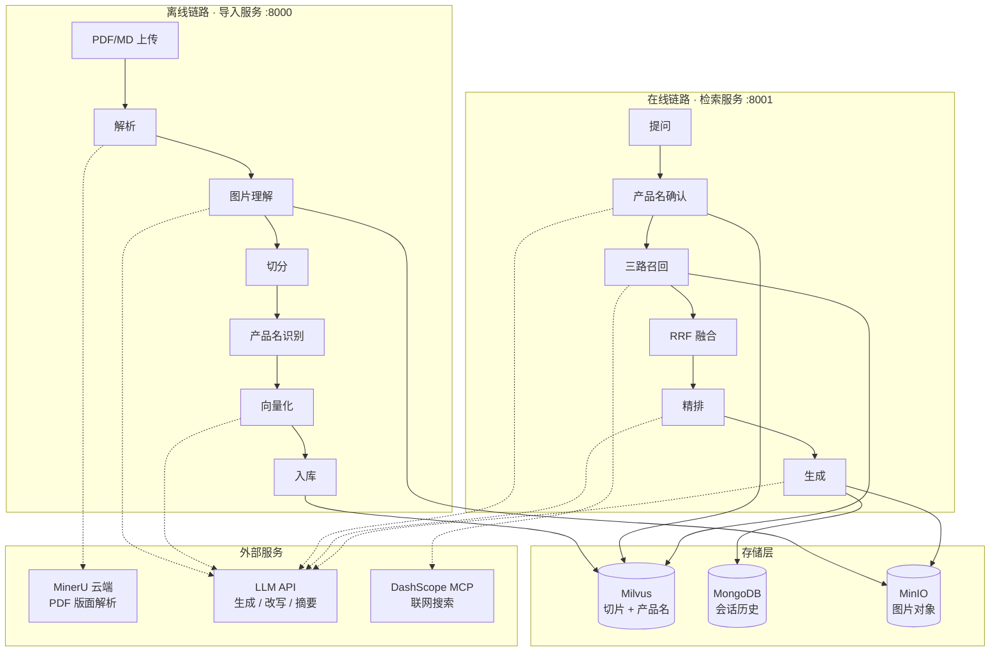
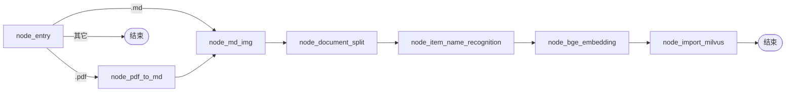
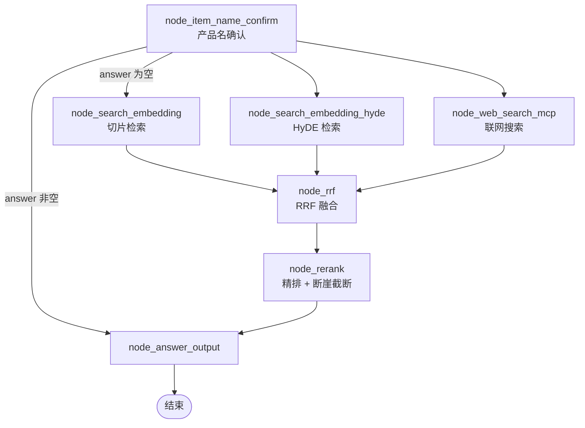
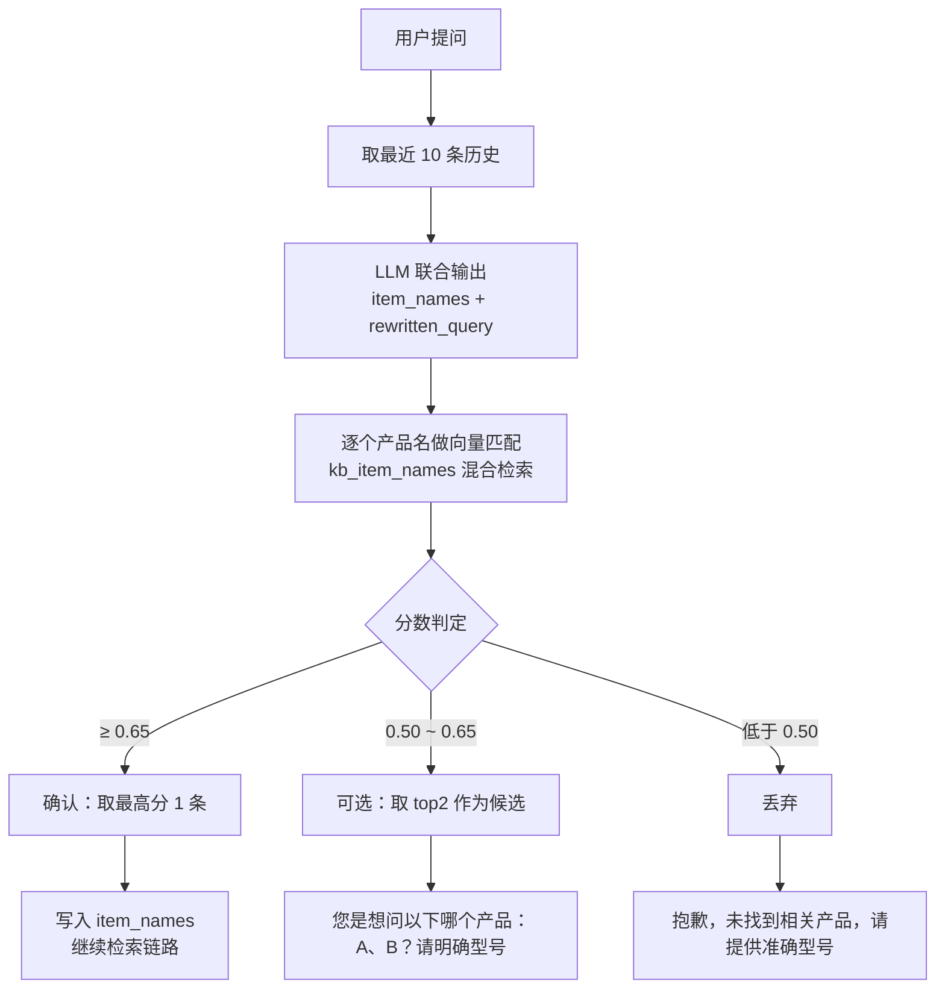

# 掌柜智库 · 架构与技术说明

面向**中文产品手册**的垂直领域 RAG 知识库。用户用口语提问（如"小象 Z2 打印机怎么换墨粉"），系统先确认问的是哪台设备，再检索手册切片，最后生成带图回答。

整套系统由两条**互相独立**的 LangGraph 工作流组成：离线导入链路负责把 PDF 手册变成可检索的向量，在线检索链路负责把用户问题变成带引用的答案。二者通过 Milvus 与 MinIO 解耦，可分别部署、分别重启。

## 系统全景



## 技术栈总览

| 层 | 选型 | 角色 |
|---|---|---|
| 编排 | LangGraph `StateGraph` | 两条链路的节点编排、条件路由、并行扇出与汇合 |
| 服务 | FastAPI + uvicorn | 导入服务 `:8000`、检索服务 `:8001`，各自独立进程 |
| 向量 | BGE-M3 | 本地推理，**同时产出稠密（1024 维）与稀疏两路向量** |
| 精排 | BGE-reranker-large | 本地推理，cross-encoder 逐条打分 |
| 向量库 | Milvus | 稠密 + 稀疏混合检索，两个 collection |
| 文档解析 | MinerU 云端 API | 版面分析 + OCR + 图表提取，输出结构化 Markdown |
| LLM | OpenAI 兼容接口 | 问题改写、产品名识别、HyDE、超长摘要、答案生成、图片描述 |
| 会话存储 | MongoDB | 会话历史，只存对话不存文档 |
| 对象存储 | MinIO | 手册内图片，公开只读桶 |
| 联网兜底 | DashScope WebSearch MCP | 知识库无命中时补充外部信息 |
| 配置 | 环境变量 + `dataclass` 装载器 | `.env` → `app/conf/` 下 7 个配置对象 |
| 部署 | Docker Compose | 基础服务四容器编排，应用侧独立运行 |

---

# 一、工作流 A：知识导入

入口 `app/import_process/agent/main_graph.py`，编译对象 `import_graph`，7 个节点串成一条直线，唯一的分支在开头按文件类型分流。



## 1. `node_entry` — 按后缀分流

只做一件事：看文件后缀，置位 `is_md_read_enabled` / `is_pdf_read_enabled`，并用 `Path.stem` 取文档名作为 `file_title`。两个开关都为假时条件边直接返回 `END`——**不报错，静默结束**。

## 2. `node_pdf_to_md` — 云端 PDF 解析

**这一步外包给了 MinerU 云端 API，不是本地跑 magic-pdf**（`pyproject.toml` 里仍声明着 `magic-pdf` 依赖，但代码零引用）。三步：

1. 申请上传地址（`POST /file-urls/batch`），请求体指定 `model_version: "vlm"`，用预签名 URL 直传（`session.trust_env=False` 屏蔽代理，避免大文件走代理超时）
2. 轮询解析结果：**超时 600s、间隔 3s**，5xx 重试、`failed` 抛错、`done` 取 `full_zip_url`
3. 下载 zip 解压，在产物里定位 `<stem>.md`（找不到就退而取 `full.md`，再退而取第一个 md）并重命名

解压产物是一个完整的数据包：Markdown 正文、`images/` 目录、`*_content_list.json`、`layout.json`。**这些结构化产物目前只用了 Markdown 和图片，版面 JSON 没有被消费**——这是后续能捡起来的信息。

## 3. `node_md_img` — 图片理解与图床化（多模态链路的核心）

这是导入链路里最有分量的一步，也是这个项目和多数开源方案拉开差距的地方。它把"图片"从检索不到的黑洞，变成可以被文本检索命中的内容。

1. **扫描图片**：遍历 `images/` 目录，用**两个正则同时匹配**两种引用形式——Markdown 的 `` 和 HTML 的 ``。之所以要匹配两种，是因为 MinerU 导出的**表格内嵌图片是 HTML 形式**。同时截取每张图在正文中**前后各 100 字符**作为上下文
2. **VLM 生成描述**：把图片 base64 编码后连同那 200 字上下文一起送给视觉模型，要求输出**中文、50 字以内**的图片标题。调用前过一道滑动窗口限流（500 次 / 60 秒）
3. **上传 + 替换**：图片传到 MinIO，然后**把正文里的图片引用原地替换掉**：
   - `` → ``
   - `` → ``

**这一步是整条多模态链路的枢纽**。因为切分节点在它之后运行，所以 **VLM 生成的图片描述文字会随正文一起进入 chunk content**——图片因此可以被纯文本向量检索命中。同时图片 URL 也留在 chunk 里，供生成阶段抽取。

替换用 `re.sub` 的 lambda 形式而非字符串拼接，因为图片摘要里可能含正则元字符。

## 4. `node_document_split` — 两级切分

**第一级：按 Markdown 标题做语义切分。** 逐行扫描，用 `^\s*#{1,6}\s.+` 识别标题，标题及其下属内容作为一个块。这里有个容易被忽略的细节：**用 ` ``` ` / `~~~` 翻转 `is_code_block` 状态机，防止代码块里的 `#` 被误判为标题**。没有标题的文档整体兜底为 `title='default'`。

**第二级：超长块递归切分。** 超过 `CHUNK_MAX_SIZE = 500` 字符的块，用 LangChain 的 `RecursiveCharacterTextSplitter(separators=['\n\n','\n'], chunk_size=200, chunk_overlap=20)` 再切一刀。二次切分后：

- `title` = `父标题_序号`
- `parent_title` = 原父标题
- `part` = 序号

这就是一组**软父子块**结构——检索命中的是细粒度的 child，但 `parent_title` 保留了它属于哪一节。切分结果同时落一份 `chunks.json` 备份到输出目录。

三个阈值都写在文件顶部：`CHUNK_MAX_SIZE = 500`、`CHUNK_SIZE = 200`、`CHUNK_OVERLAP = 20`。**`CHUNK_SIZE` 旁边的注释原文是「小值方便测试切割」**——这是个待复核值，详见「已知问题」。

## 5. `node_item_name_recognition` — 文档级产品名识别

切完之后，反向回答一个问题：**这份文档讲的是哪台设备？**

取**前 5 个 chunk**、每块截断 800 字符、总上下文封顶 10000 字符，交给 LLM 识别出带品牌和型号的完整商品名。识别为空时回退用 `file_title`。拿到结果后**回写到该文档的每一个 chunk 的 `item_name` 字段**——这个字段是后面一切过滤和确认的基础。

同时把产品名单独向量化，写进另一张表 `kb_item_names`，**先按产品名删再插**，保证重复导入不产生脏数据。

## 6. `node_bge_embedding` — 语义增强 + 向量化

不是直接对 chunk 原文做 embedding，而是拼一个前缀：

```
主体：{item_name},内容:{content}
```

让向量更贴近"用户在问这台设备"的真实查询分布。批量步长 5，**逐批 try/except**——单批失败跳过而不是整条链路崩掉。

产出 `dense_vector`（1024 维）与 `sparse_vector`（`{维度: 权重}` 稀疏字典）。BGE-M3 侧开启了 `normalize_embeddings=True` 做 L2 归一化，这是为了配合 Milvus 侧的**内积（IP）**度量——归一化之后内积等价于余弦相似度，但省掉了余弦的计算开销。

## 7. `node_import_milvus` — 幂等入库

集合不存在则按 schema 建表建索引，然后**按 `item_name` 先删后插**。这一步让重复导入同一份手册是安全的：不会留下上一版的残留切片。

---

# 二、工作流 B：知识检索

入口 `app/query_process/agent/main_graph.py`，编译对象 `query_graph`。与导入链路的直线结构不同，这条链路有一个**三路并行扇出 + 汇合**的结构。



**扇出与汇合**：条件边返回一个三元组，LangGraph 在同一个 superstep 里并行启动三个检索节点；`node_rrf` 作为 join 点，等三路全部完成才执行。

**分流判据是一个字符串**：`node_item_name_confirm` 把澄清话术写进 `state['answer']`，路由函数只看这个字段是否非空。非空说明"要么产品名没确认、要么压根没法作答"，直接跳到输出节点把话术流式吐给用户；为空说明产品名已确认，正常走检索。

## 1. `node_item_name_confirm` — 产品名确认与澄清（详见下一节）

## 2. `node_search_embedding` — 主检索路

对改写后的问题做混合检索。过滤表达式是 `item_name in [...]`——**只在该产品名对应的切片里检索**，这是垂直领域 RAG 最有效的一道前置收窄。

混合检索参数：稠密与稀疏权重 `(0.8, 0.2)`，`norm_score=True`，**融合后取 `limit=7`**，返回字段含 `chunk_id / content / title / parent_title / part / file_title`。

## 3. `node_search_embedding_hyde` — HyDE 假设性文档检索

先用 LLM 针对问题**生成一段假设性的答案**，再把"改写后的问题 + 假设答案"拼起来做 embedding 检索。原理是：假设答案的用词分布比问题本身更接近真实文档，因此更容易命中。

参数与主检索路一致，只有 `limit=5` 不同。

## 4. `node_web_search_mcp` — 联网兜底

通过阿里百炼的 DashScope MCP 调 `bailian_web_search`，取回 5 条网页摘要。用于手册里查不到、但属于常识或时效性信息的问题。用 `asyncio.run` 把异步 MCP 调用包成同步，以适配 LangGraph 的同步节点。

## 5. `node_rrf` — 倒数排名融合

对**两路向量召回**（主路 + HyDE 路）做 RRF 融合，联网结果不参与 RRF 而是直接进下一步。

```
score(chunk) = Σ  1 / (rank_i + k) × weight_i
```

`k = 60`、`weights = (1.0, 1.0)`、最终取 `top = 5`。`k=60` 是 RRF 原论文的经验值，作用是**削弱头部排名的绝对优势**——排名第 1 和第 2 的差距，在 `k=60` 时被压得很小，让两路都认可的文档能浮上来。

两个实现细节：`chunk_id` 取 `chunk.get('id') or chunk['entity']['chunk_id']`（兼容两种返回结构）；`entity_dict.setdefault` 而非直接赋值，**保证同一 chunk 在两路里出现时保留第一次的 entity**。

## 6. `node_rerank` — 精排 + 动态 TopK

先把联网结果和 RRF 结果**统一成同一种结构** `{title, text, url, type, score}`（`type` 区分 `web` / `milvus`），然后交给 cross-encoder 逐条打分。

**超长处理**：reranker 的输入上限是 **512 token**。逐条检查 `问题 + 内容` 的 token 数，超限就调 LLM 做摘要压缩后重试，`max_retry=4`——**这个重试上限本身就说明超长是常态而非异常**。

**动态 TopK（"断崖截断"）**：不是固定取前 K 条，而是从 `MIN_TOPK=1` 起向后扫描，遇到**分数断崖**就停：

- 绝对断崖：相邻分差 `> 0.3`
- 相对断崖：相邻分差 / 前一条分数 `> 0.5`

上界是 `min(10, 候选数)`。也就是说 TopK 在 `[1, 10]` 之间由数据自己决定——**如果检索结果确实只有 2 条相关，就没必要凑满 10 条去污染上下文**。

## 7. `node_answer_output` — 生成与图文返回

组装 prompt 时，每个切片带上标题、匹配度得分、来源类型（网络搜索 / 向量查询），加上最近 10 条历史对话和已确认的产品名。

生成支持流式与非流式两条路径。流式逐 token 通过 SSE 推 `delta` 事件；生成完成后落库到 Mongo，并从答案与切片里**抽取图片 URL**（正则匹配 Markdown 图片语法 + 按 `.png/.jpg/.jpeg/.gif/.svg` 后缀白名单过滤联网结果），去重后写进 `state['image_urls']`，随最终答案一起返回给前端。

---

# 三、产品名确认与澄清：这个项目最有差异化的设计

产品手册场景有个绕不开的问题：**同一个系列下有几十个型号，用户通常只记得自己那台的一部分型号名**。如果直接把"小象 Z2 怎么换墨粉"丢进向量检索，召回的是整个系列混在一起的内容——同系列手册的安全须知、按键布局、耗材说明高度雷同，检索质量会断崖式下跌。

传统 RAG 的解法是元数据预过滤，但那要求用户**先把型号说对**。这个节点的思路反过来：**先确认用户问的是哪台设备，确认不了就主动问**。

## 完整流程



## 关键点

**历史上的问题一次性解决。** LLM 同时输出两样东西：`item_names`（从当前问题 + 历史里提取的候选设备）和 `rewritten_query`（把依赖上下文的省略式提问改写成独立完整的问题）。历史里 10 条对话的作用就在这里——"那它怎么换墨粉"这种指代，只有结合上文才能改写成"小象 Z2 怎么换墨粉"。这属于 **conversational query rewriting**，和澄清反问是互补的两件事：能自动补全的就别打扰用户。

**双阈值分级，而不是一刀切。** `≥ 0.65` 直接确认；`0.50 ~ 0.65` 不猜，把 top2 作为选项抛给用户；`< 0.50` 直接说没找到。这样把"确定"和"接近但不肯定"两种状态区分开了——**不确定时反问的成本，远低于猜错后给出另一台设备答案的成本**。

**候选选项全部来自语料检索结果，绝不由 LLM 生成。** 这是这个设计里最重要的一条约束。让 LLM 自由生成澄清选项，它会给出**语料里根本不存在**的型号——用户选了一个不存在的型号，系统再怎么也检索不到。所以候选必须来自 `kb_item_names` 这张表，也就是**已经真实入库的产品名**。

**同一产品名只取一条。** LLM 可能从一句话里抽出多个候选产品名，每个候选各自去检索。命中多个高分时**只取最高分那一条**，不合并、不拼接。

**这一步的产物会落库。** 用户的原始问题、改写后的问题、确认到的产品名一起写进 Mongo——后续做 bad case 分析时，这里能直接看出"是改写错了还是召回错了"。

> 这类交互在业界有现成的名字：任务层面叫 **product demand clarification**，方法层面叫 **clarifying question generation**（或 facet-based clarification）。注意不要用 `entity disambiguation` 来描述它——那个词指全自动的实体链接，天然不包含向用户反问；也不要用 `adaptive RAG`——那个词指系统对"要不要检索、检索几次"的自适应，和用户交互无关。

---

# 四、关键设计决策

**为什么用稠密 + 稀疏混合检索，而不是纯向量？**
产品手册里大量出现型号、参数、故障码这类**精确字符串**——`HAK180`、`E-02`、`2.4GHz`。这类 token 在稠密向量里几乎不占权重，纯向量检索会漏。BGE-M3 的价值就在于**一个模型同时产出两种向量**，不需要额外维护一套 BM25 索引，稀疏路就能把精确匹配的能力补回来。权重 `(0.8, 0.2)` 偏向稠密，因为语义匹配仍是主要需求。

**为什么 RRF 而不是加权求和？**
系统中其实**两种融合都存在**：Milvus 层用 `WeightedRanker(0.8, 0.2)` 融合稠密/稀疏，应用层用 RRF 融合两路召回。原因是两者的输入性质不同——稠密和稀疏都来自同一个模型、同一批数据，分数可比，适合加权；而主检索路和 HyDE 路是**两次独立的检索**，分数分布不可直接比较，用只依赖排名、不依赖分数绝对值的 RRF 更稳妥。

**为什么 MinerU 走云端而不是本地 magic-pdf？**
本地跑版面分析 + OCR 对显存和依赖的要求很高，而解析是**离线一次性**的、不在请求链路上——把它放到云端 API，本地只保留推理时必需的 BGE 模型，**把有限的本地算力留给检索链路**。代价是解析依赖网络、有外部服务成本、手册内容会出本地。

**为什么是"断崖截断"而不是固定 TopK？**
固定 TopK 的问题在于**它假设每次检索都能找到那么多相关内容**。实际查询里既有能命中 8 条的宽泛问题，也有只能命中 1 条的精确问题；固定取 5 条意味着后一种情况会塞进 4 条噪音。断崖截断让数据决定截断位置。

**为什么图片要做成"摘要进正文 + URL 留字段"而不是走图片向量检索？**
图片向量检索需要引入 CLIP 一类的视觉编码器，且图片与文本的跨模态对齐在手册场景下收益不稳定。而把 VLM 摘要直接写进正文，**图片就自动获得了与正文完全一致的检索通路**——不需要新模型、不需要新索引、不需要改检索逻辑，改动集中在导入侧一个节点里。这是用最小的架构改动换取"图片可被检索"的能力。

---

# 五、数据层

## Milvus：两个 collection

**`kb_chunks`（切片主表）**——`chunk_id` 自增主键、`file_title` / `item_name` / `title` / `parent_title` / `part` / `content` 六个标量字段、`dense_vector`（FLOAT_VECTOR，1024 维）、`sparse_vector`（SPARSE_FLOAT_VECTOR）。索引：稠密 `AUTOINDEX`，稀疏 `SPARSE_INVERTED_INDEX` 配 `DAAT_MAXSCORE`，**两者度量均为 IP**。

`enable_dynamic_field` 显式关闭——这行不是随手写的。动态字段会产生隐藏的 `$meta` JSON 字段，而 **Milvus v3.0.0 的 JSON Shredding 为它生成 `shredding_data` 时存在路径重复拼接的缺陷，会导致重启后段加载失败**。本集合所有字段均已显式声明，关掉动态字段即可绕开。这是排查过的坑，不是默认行为。

**`kb_item_names`（产品名表）**——`item_name` + 双向量，索引同构。

检索侧封装在 `app/clients/milvus_utils.py`：`create_hybrid_search_requests` 构造一对 `AnnSearchRequest`（稠密 + 稀疏），`hybrid_search` 用 `WeightedRanker` 融合。另有一个 `fetch_chunks_by_chunk_ids` 做**主键批量补全查询**（batch 100），用于"手上只有 chunk_id、需要补回正文"的场景——优先走主键 `get`，失败回退 `query` 过滤。

## MongoDB：只存对话

库 `RAG_zhiku`，集合 `chat_message`，复合索引 `(session_id 升序, ts 降序)`。字段：`session_id / role / text / rewritten_query / item_names / image_urls / ts`。

**不存原始文档、不存向量**——它只承担"让多轮对话能接上下文"这一个职责。客户端设了 `serverSelectionTimeoutMS=5000`，远端不可达时快速失败而不是长时间阻塞。

## MinIO：公开只读的图床

桶在首次调用时按需创建，并设置为**公开只读策略**（匿名 `s3:GetObject`）。图片按 `{前缀}/{文档名}/{图片名}` 组织，每次导入前先清理该文档的旧对象前缀，避免重复导入残留孤儿图片。

写入点只有一个（`node_md_img`），读取方式就是**匿名 HTTP GET**——应用侧不做签名访问。

## 进程内状态

任务进度与 SSE 队列**全部是进程内存**：`task_utils` 用四个字典跟踪任务状态与结果，`sse_utils` 用 `session_id → queue.Queue` 维护流式通道。没有 Redis、没有 Celery——导入任务靠 FastAPI `BackgroundTasks` 异步执行，SSE 靠 `run_in_executor` 从队列取数据避免阻塞事件循环。

这个选择的直接后果写在「已知问题」里。

---

# 六、部署形态

**基础服务容器化，应用侧独立运行。**

`deploy/docker-compose.yml` 编排四个容器：etcd（Milvus 的元数据依赖）、MinIO、MongoDB（开启 `--auth`）、Milvus（standalone 模式）。四个容器都配了 healthcheck 和 `restart: unless-stopped`。

端口暴露遵循最小化原则：**只映射应用真正需要访问的端口**，etcd 的客户端端口和 Milvus 的健康检查端口留在容器内网不对外。

安全配置有三层：Milvus 通过 `user.yaml` 开启鉴权；MongoDB 由 `mongo-init.js` 在首次初始化时创建**只对业务库有 `readWrite` 权限**的应用账号（密码走环境变量，不写死在脚本里）；MinIO 的访问密钥由环境变量注入。

应用侧的接入信息全部通过 `.env` 读取，代码里用 `<MILVUS_HOST>:19530`、`<MINIO_HOST>:9000`、`<MONGO_HOST>:27017` 这类参数化的方式引用，**换环境只改配置不改代码**。

服务器初始化脚本 `deploy/remote_setup.sh` 是幂等的：装 Docker、写镜像加速、建目录、**预建向量库数据卷并修正属主**（这一步是必须的，Milvus 容器以固定非 root uid 运行，卷属主不对会直接起不来）。

> 注意：**应用服务本身（:8000 / :8001）目前没有生产部署方案**——没有 Dockerfile、没有进程守护、没有反向代理。当前是两个 uvicorn 进程直接跑。这是部署形态上最大的一块空白。

---

# 七、已知问题与限制

按"面试会被追问"的程度排序。

| # | 问题 | 影响 |
|---|---|---|
| 1 | **切分节点没有表格保护**。只有标题语义切分 + 递归字符切分，Markdown 表格一旦超过 `CHUNK_MAX_SIZE=500` 就会**从行中间断开，且表头不会重复** | 手册里的参数表、故障代码表是高频查询目标，断开的表格既检索不准，喂给 LLM 也读不懂 |
| 2 | **`CHUNK_SIZE=200` 是测试值**。源码注释原文「小值方便测试切割」，说明这个值是调试时留下的，没有按生产语料标定过 | 中文 200 字符往往不足以让一个"注意事项"自洽，召回质量受影响 |
| 3 | **完全没有评测体系**。没有评测集、没有 RAGAS 一类的指标、没有 CI 门禁 | 所有参数（阈值、权重、`k`、`chunk_size`）都是凭经验拍的，**任何调参都无法证明是变好还是变坏** |
| 4 | **任务状态与 SSE 队列在进程内存** | uvicorn 只能单 worker 跑，重启即丢任务状态；无法水平扩容 |
| 5 | **澄清是一次性反问**。用户回答后需要重新发一遍完整问题，系统不保留待澄清的上下文 | 多轮体验断裂，且用户的新回复要重新走一遍产品名确认 |
| 6 | **每个查询都无条件跑三路召回**。HyDE 和联网搜索对"问题已经很明确"的查询是纯浪费 | 延迟和外部 API 成本随查询量线性上涨 |
| 7 | **reranker 512 token 上限逼出一层 LLM 摘要压缩**，`max_retry=4` | 摘要既增加延迟又丢信息，且摘要本身要花钱。换长上下文 reranker 可以直接删掉这条路径 |
| 8 | **阈值与融合参数强耦合**。`0.65` / `0.50` 是在 `norm_score=True` + `(0.8,0.2)` 这个特定归一化空间里标定的 | **任何 ranker、权重或 `norm_score` 变更都必须重新标定阈值**，否则会静默失效 |
| 9 | **只支持 `.md` / `.pdf`**。其它后缀在入口节点静默降级到 `END`，不报错也不提示 | 用户上传 docx 会看到"任务完成了"但知识库里什么都没有 |
| 10 | **三处注释与代码不符**：RRF 的 docstring 公式写成 `1.0/k + rank*weight`（实际是 `1.0/(rank+k)*weight`）；可选阈值注释写 `0.55`（实际是 `0.50`）；稠密向量参数注释写 COSINE（实际是 IP） | 不会导致运行错误，但会误导后续维护者——尤其是 RRF 那条 |
| 11 | **公网暴露面偏大**：基础服务的端口直接映射到公网，检索服务 CORS 为 `allow_origins=["*"]`，MinIO 桶为匿名只读 | 当前靠云安全组的 IP 白名单兜底，应用层没有第二道防线 |

另有两处自测代码的问题（不影响生产运行）：导入图的 `__main__` 自测把 `is_pdf_read_enabled` 和 `is_md_read_enabled` **都设成了 `False`**，图会直接走到 `END`，跑不出任何东西；同处断言切片含 `chunk_id`，但入库节点不回写该字段，导致日志里恒显示「Milvus 入库：否」，是误报。

---

# 八、与开源 RAG 项目的对比

选四个**当前仍在活跃维护**的项目对比。四个维度上最直接可比的是前三个——它们和本项目同属"开箱即用的 RAG 系统"而非底层库。

| 维度 | 本项目 | RAGFlow | Dify | FastGPT | LightRAG |
|---|---|---|---|---|---|
| 形态 | 垂直领域 RAG 服务 | RAG 引擎 + Agent 平台 | LLM 应用平台 | Agent 构建平台 | 图 RAG 框架 |
| 文档解析 | 外包 MinerU 云端（版面 + OCR + 图表） | **自带 DeepDoc**：版面识别 + 表格结构识别 + 扫描件旋转纠正 | 无自带版面分析/OCR | 无自带，需外接 Marker / MinerU | 四引擎可切换（含 MinerU / Docling） |
| 切分 | 标题语义切分 + 递归二次切分 | **模板化**：通用 / 手册按章节 / 表格每行一块 等 | 通用 / 父子块 | 按大小或字符 + 自定义分隔符 | **四种策略**含向量语义、段落语义 |
| 混合检索 | 稠密 + 稀疏（BGE-M3 单模型双向量） | BM25 + 稠密 | 语义 / 全文 / 混合 | 向量 / 全文 / 混合 | **主分支无稀疏检索** |
| 融合方式 | Milvus 层加权求和 + 应用层 **RRF** | 加权求和 | 加权求和 | **RRF** | — |
| Rerank | BGE-reranker-large，**默认开启** | 可插拔，默认关 | 可插拔，默认关 | 可插拔 | 可插拔，默认关 |
| 多模态 | VLM 摘要进正文 + 图床 + 答案带图，**导入到生成全链路贯通** | VLM 作为模型类型接入 | 图片作为 chunk 附件挂载 | 图片索引（商业版） | 独立 VLM 角色 + 多模态知识图谱 |
| 编排 | **LangGraph** | **LangGraph** | 自研工作流引擎 | 自研 Flow | 并发流水线 |
| 内置评测 | **无** | 未见内置 | 未见内置 | **有**（应用评测 Beta） | **有**（RAGAS + Langfuse） |
| 许可 | — | Apache-2.0 | Apache-2.0 + 附加条款 | Apache-2.0 + 附加条款 | MIT |

**逐项借鉴点：**

**RAGFlow** 是四个里唯一的同栈对手——它也用 LangGraph，且版本被硬钉在 `langgraph==1.2.0`。它最值得借鉴的是**切分模板化**：针对手册类文档有专门的"按章节结构切"模板，本质上和本项目的标题语义切分是同一个思路，但它把这件事做成了可配置的多套模板。另外它的 DeepDoc 把版面分析、表格结构识别、扫描件旋转纠正全部内置，**表格是作为结构化对象处理的**而不是当纯文本切——这正是本项目第 1 号已知问题的解法。值得注意的是它上游已经在做能力收敛：v0.27.0 起在 UI 中弃用了 GraphRAG 与 RAPTOR。

**FastGPT** 与本项目路径最接近——**中文场景、同样用 RRF 做混合检索融合**。它最值得借鉴的是**内置评测**：支持导入 CSV 问答对（最多 1000 组）跑回答准确性评测。它还明确提示过一个坑：**Cohere 系 reranker 对中文的效果不如 BGE** ——这反过来印证了本项目选 BGE-reranker-large 是合理选择。不过要注意它的许可带附加条款，且新版强制要求走它家的 AI Proxy。

**Dify** 的价值在于**产品化程度**，它把 RAG 做成了可视化编排的一环，但技术上没有超出前两者的地方：无自带版面分析、融合用加权求和、rerank 默认关闭。它的工作流引擎是自研的（依赖里没有 langchain/langgraph）。它的图片处理方式是**把图片作为 chunk 的附件挂载**、URL 保留在 chunk 文本中——和本项目的思路接近，但本项目额外让 VLM 生成的摘要进入了正文，因此图片摘要本身是可被检索的。

**LightRAG** 代表的是**另一条技术路线**：不追求把切片检索做到极致，而是先把文档抽成实体关系图，检索时走图。它的双层检索设计（低层实体 + 高层主题）确实解决了纯切片检索答不了"总结一下整个系列"这类全局问题。两个值得注意的事实：**它的主分支至今没有稀疏/BM25 检索**（相关 PR 被维护者以"O(N) 全量重建、多 worker 不一致"为由拒绝合并），以及它的评测链路是四个里最完整的。对本项目的意义是：**图增强是"要不要做"的战略选择，不是"做得够不够好"的优化项**——在当前阶段引入图谱的复杂度远大于收益。

**几个明确不该参照的项目**：Verba 已于 2026-06 归档停止维护；Microsoft GraphRAG 已转入维护模式（官方声明只接受 bug 修复、不再加新功能）；QAnything 的最后一个版本发布于 2024-08，代码提交停滞至今。

---

# 九、改进方向

按**投入产出比**排序。P0 是"不做会持续失血"的，P1 是"做了立刻能感知收益"的，P2 是"方向正确但依赖前置条件"的。

## P0

**1. 建立评测体系（最高优先级）**
这是当前最大的缺口，也是所有其他改进的前置条件——**没有评测，下面所有调优都只能靠感觉**。最小可行路径：从真实用户问题里挑 100–200 条（覆盖不同难度和查询类型）构成评测集并入版本控制；接 RAGAS，**优先用 `Context Entity Recall`**——它专门度量"命名实体"的召回，对"产品型号有没有被检索回来"这个场景是量身定做的；分阶段看指标（召回看 Recall@K、精排看 MRR/nDCG、生成看忠实度）。先用 20–30 条做每 PR 的门禁，成本很低但能立刻挡住回归。

**2. 表格原子化**
直接改 `node_document_split`：在标题切分之后、递归切分之前加一步，识别 Markdown 表格块（连续的 `|` 行 + 分隔行）与 HTML `<table>` 块，**整体跳过递归切分**；超过 500 字符必须切时，**按行组切并在每块重复表头和表名**；chunk schema 增加 `type` 字段区分正文 / 表格 / 图片，检索时对表格块加分数乘子。这一步直接消灭第 1 号已知问题。

**3. 复核 `CHUNK_SIZE`**
在评测体系建好之后做 A/B：`200/20` vs `400/80`。中文经验值普遍落在 300–500 字符区间，但必须以本项目的实际语料定夺。

## P1

**4. 加查询路由。** 当前每个查询无条件跑三路。实测数据表明**没有一种查询改写技术是全局最优的**——事实型问题 HyDE 收益明显，多跳问题分解更有效，模糊查询多路改写更好。用一个便宜的分类器给查询打标，只对需要的类型跑对应路径，**能直接砍掉无效的延迟和第三方 API 成本**。

**5. 扩展成多路改写（RAG-Fusion）。** 生成 3 条查询变体各检索一次，再用 RRF 合并。**RRF 实现已经在了，从两路扩到四路基本只是加一层循环**，是现有代码上性价比最高的一次扩展。

**6. 把 `expr` 从单一过滤扩展成多级过滤。** 切片检索目前已用 `expr` 做 `item_name in [...]` 过滤，但**无法按版本、章节、文档进一步收窄**。手册场景里"同一型号不同年份版本"是常态，把版本、章节作为 chunk 字段并纳入 `expr`，能显著提升多版本场景的准确率。

**7. 引入 Contextual Retrieval。** 对每个 chunk 用便宜模型生成一段 50–100 字符的上下文前缀（如"本段来自《XX 手册》第 3 章安全规范"）再索引。**对手册场景收益尤其大**——同一个表格在不同型号手册里长得几乎一样，缺的正是"这是哪台设备的"这层上下文。用 prompt caching 可以把生成成本压掉约九成。

**8. 换长上下文 reranker。** 换掉 512 token 上限的模型（如 `bge-reranker-v2-m3`），**可以直接删掉那层 LLM 摘要压缩逻辑**——既省一次 LLM 调用，又避免了摘要带来的信息损失。

**9. 父子块显式化。** 现在 `parent_title` + `part` 已经是软父子结构了，再往前一步就是**检索 child、返回 parent**——用细粒度块保证召回精度，用父块保证喂给 LLM 的上下文完整。这是精度/召回平衡里结构最简单、成本最低的一种做法。

## P2

**10. 澄清升级为可暂停/恢复的交互。** LangGraph 原生支持在节点内 `interrupt()` 并在用户回答后 `Command(resume=...)` 恢复，**本项目已有这个依赖，零新增成本**。改造后用户回答型号时能带着完整的状态继续走检索链路，不用重发问题。注意 `interrupt()` 恢复时会**从节点开头重新执行**，所以该节点里的落库、任务状态更新等副作用必须做成幂等。

**11. 区分歧义类型。** 现在只有一句硬编码的澄清文案，对"版本歧义"（同型号不同年份的手册）完全不适用。按型号歧义 / 版本歧义 / 参数歧义 / 指代歧义分别生成不同的澄清问题，能覆盖更多真实场景。

**12. 给澄清加"该不该问"的判定和轮次上限。** 研究结论很明确：**只对最不确定的那部分查询发起澄清，收益远高于无差别地澄清**，而且低质量的澄清问题会直接降低用户满意度。加一个不确定性阈值 + 澄清轮次上限 + 兜底策略（比如连续两轮没确认就退化为全库检索）。

**13. 接可观测性。** 现有的任务日志不是可观测性。接 Langfuse 或 OpenTelemetry 做链路追踪，**和评测体系配套使用**——只评测不追踪，出了问题定位不到是哪一步坏的。

## 关于安全

上面 11 条已知问题里的第 11 条（公网暴露）不在这个列表里，因为它不属于"功能改进"而属于**配置收口**：应用层加鉴权、CORS 收敛到具体来源、MinIO 改为预签名 URL 访问。这些不涉及架构改动，但需要先确定部署形态（见第六节的空白）。

---

# 十、面试问答要点

按被追问的概率排序。回答的要点是**讲清权衡**，而不是背参数。

**Q：为什么用 BGE-M3 而不是分别用 embedding 模型 + BM25？**
一个模型同时出稠密和稀疏两路向量，不需要额外维护一套 BM25 索引和一套分词逻辑，索引侧只有一份数据。代价是稀疏向量由模型生成，可解释性和可控性不如 BM25。

**Q：混合检索的权重 0.8/0.2 是怎么定的？**
凭经验定的，偏向稠密。**这是这套参数最脆弱的地方**——权重、`norm_score` 和后面产品名确认的阈值是在同一个归一化空间里联合标定的，改任何一个都要重新标定阈值。所以第一优先级是建评测体系，之后这些值才能被真正优化。

**Q：RRF 的 k 为什么取 60？**
RRF 原论文的经验值。它的作用是削弱头部排名的绝对优势——`k` 越大，排名 1 和排名 2 的得分差距越小，两路都认可的文档越容易浮上来。取 60 是业界最通行的默认值，本项目没有针对语料重新标定。

**Q：为什么系统中同时存在加权求和和 RRF 两种融合？**
因为输入性质不同。Milvus 层的加权求和融合的是**同一个模型产出的稠密和稀疏向量**，分数可比；应用层的 RRF 融合的是**两次完全独立的检索**（主路和 HyDE 路），分数分布不可直接比较，只能用依赖排名的 RRF。

**Q：chunk_size 200 是不是太小了？**
**确实偏小，而且这个值是测试遗留的**——源码注释写着「小值方便测试切割」。中文 200 字符常常不足以让一段"注意事项"自洽。但更正它需要评测集支撑，否则只是把猜测换成另一个猜测。

**Q：动态 TopK 和固定 TopK 比，优势在哪？**
固定 TopK 假设每次检索都能找到那么多相关内容，实际查询的命中数量差别很大。断崖截断让数据决定截断位置——**检索结果只有 2 条相关时就返回 2 条，不凑数污染上下文**。代价是多了一个需要标定的参数，而且**这个做法是自研的、没有业界对标**，所以更需要自建评测来证明它确实优于固定 TopK。

**Q：超长文档怎么处理？reranker 有长度限制吧？**
有，512 token。超限的会先让 LLM 摘要压缩再打分，最多重试 4 次。**但这个设计本身是个妥协**——重试上限设到 4 说明超长是常态；摘要既加延迟又丢信息。更合理的做法是换长上下文的 reranker，直接删掉这条路径。

**Q：用户只说"打印机怎么换墨粉"，没说型号，怎么处理？**
这正是产品名确认节点的作用。先用 LLM 从当前问题和历史对话里提取候选产品名，逐个去产品名表做向量匹配，然后**双阈值分级**：`≥0.65` 直接确认、`0.50~0.65` 把 top2 抛给用户选、更低就说没找到。把"确定"和"接近但不肯定"分开，是因为**猜错的成本远高于反问的成本**——猜错会给出另一台设备的答案，用户还看不出来。

**Q：澄清的选项是 LLM 生成的吗？**
**不是，必须是语料检索结果。** 这是设计里刻意约束的一条。让 LLM 自由生成澄清选项，它会给出语料里根本不存在的型号，用户选了也检索不到。所以候选全部来自已经真实入库的产品名表。

**Q：多轮对话的指代怎么解决？**
LLM 在提取产品名的同时输出改写后的问题，把"那它怎么换墨粉"这类依赖上下文的省略式提问改写为独立完整的问题。属于 conversational query rewriting，和澄清反问是互补的：**能自动补全的就不要打扰用户**。

**Q：图片是怎么做到能被检索到的？**
在导入阶段，图片先过 VLM 生成 50 字以内的中文摘要，然后把正文里的图片引用**原地替换**成 ``。因为切分节点在这之后运行，摘要文字就自然进入了 chunk content，**图片获得了和正文完全一致的检索通路**——不需要引入 CLIP 一类的视觉编码器，也不需要新建图片索引。答案生成后再从切片里把图片 URL 抽出来返回给前端。

**Q：为什么用云端 API 做 PDF 解析，不本地部署？**
解析是离线一次性的、不在请求链路上，而本地跑版面分析 + OCR 对算力和依赖要求很高。放到云端可以把本地算力全部留给检索链路。代价是依赖网络、有外部成本，以及**手册内容要出本地**——如果语料涉密，这个选择就得重新评估。

**Q：为什么选 LangGraph？**
两条链路都是**有状态、有分支、有并行**的流程：导入链路入口要按文件类型分流，检索链路要做三路并行扇出再汇合。这类需求用状态图表达最自然，而且节点之间通过类型化的 state 传递数据，新增节点的成本很低。检索链路的三路并行是 LangGraph 的 superstep 机制自动调度的——条件边返回多个节点名，它们就在同一轮里并发执行。

**Q：这套系统最大的问题是什么？**
**没有评测体系。** 所有参数——阈值 `0.65`/`0.50`、权重 `0.8/0.2`、`k=60`、`chunk_size=200`——都是凭经验拍的，**没有任何数据能证明它们是最优的，改一个数也无法判断是变好还是变坏**。这是当前所有问题的根源，也是第一优先级。

**Q：如果要重做一遍，你会怎么做？**
先建评测集再调参。现在这套系统的参数是"先有实现、后有调参"，但调参缺了测评这一环，等于闭着眼睛优化。另外会把表格当作结构化对象来处理而不是纯文本，以及在切分阶段就把版本、章节写成显式字段，避免后面想做多级过滤时无字段可用。
