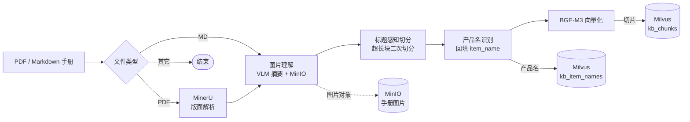
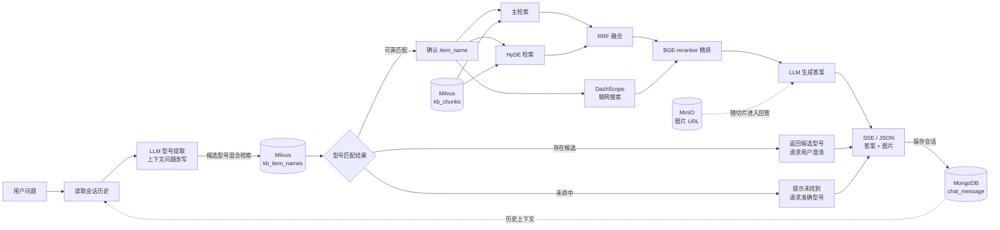

# ManualRAG｜产品手册智能问答系统

<div align="center">

面向产品手册的垂直领域 RAG 系统。先确认用户所问的产品型号，再检索对应手册，基于命中内容生成答案并回传配图。


</div>

> 示例问题：**“小象 Z2 打印机怎么换墨粉？”**<br>
> 系统会先识别并确认设备，再只检索该型号相关的手册内容，避免同系列型号的说明互相污染。

## 核心能力

| 能力 | 实现方式 | 解决的问题 |
|---|---|---|
| **产品型号确认** | LLM 抽取候选型号，检索 `kb_item_names`（产品名），双阈值确认、澄清或拒答 | 手册型号多、用户表述模糊，防止跨型号检索 |
| **混合召回** | BGE-M3 同时生成 1024 维稠密向量与稀疏向量，Milvus 加权融合 | 兼顾语义相似与型号、参数、故障码等精确匹配 |
| **多路增强检索** | 主检索 + HyDE 假设答案检索 + DashScope 联网搜索并行执行 | 提升复杂问法与知识库未覆盖问题的召回能力 |
| **融合与精排** | RRF融合两路本地召回，BGE-reranker-large 统一精排，按分数断崖动态截断 TopK | 减少无关上下文，控制生成质量与成本 |
| **图文问答** | MinerU 解析手册，VLM 生成图片摘要，摘要与 MinIO URL 回写正文 | 让图片可被文本检索命中，并在答案中展示原图 |
| **多轮对话** | MongoDB 保存会话，基于最近 10 条历史完成指代消解与问题改写 | 支持“那它怎么换墨粉？”等上下文依赖问题 |

## Agent 工作流

### 1. 离线导入流程



### 2. 在线查询流程



两条链路可独立部署、独立重启，通过 Milvus、MinIO 和 MongoDB 解耦：

- **离线导入 Agent**：`app/import_process/agent/main_graph.py`，负责解析、切分、识别产品名、向量化和幂等入库。
- **在线问答 Agent**：`app/query_process/agent/main_graph.py`，负责型号确认、多路检索、融合精排、答案生成与会话持久化。

## 技术栈

| 层级 | 选型 | 职责 |
|---|---|---|
| 工作流 | LangGraph `StateGraph` | 状态传递、条件路由、并行扇出与汇合 |
| 服务 | FastAPI + Uvicorn | 导入与问答服务 |
| 向量与精排 | BGE-M3、BGE-reranker-large | 本地生成稠密/稀疏向量并进行 Cross-Encoder 精排 |
| 向量库 | Milvus 3.0 | `kb_chunks` 切片检索、`kb_item_names` 型号匹配 |
| 文档解析 | MinerU 云端 API | PDF 版面分析、OCR、图表提取与 Markdown 输出 |
| 大模型 | OpenAI 兼容接口 | 问题改写、型号识别、HyDE、图片摘要与答案生成 |
| 数据存储 | MongoDB、MinIO | 会话历史、手册图片对象 |
| 联网检索 | DashScope WebSearch MCP | 知识库之外的公共信息补充 |
| 基础部署 | Docker Compose | etcd、Milvus、MongoDB、MinIO 四容器编排 |

## 快速开始

### 1. 环境要求

- Python `3.12+`，依赖管理使用 [`uv`](https://docs.astral.sh/uv/)
- Docker 与 Docker Compose 插件
- 推荐 NVIDIA GPU，用于 BGE-M3 与 BGE-reranker
- 一个 OpenAI 兼容的 LLM API，以及 MinerU、DashScope MCP 的访问凭据

### 2. 启动基础服务

```bash
cd deploy
# 先按下方配置表创建 deploy/.env，用于 Compose 变量替换
docker compose up -d
cd ..
```

Compose 会启动 `etcd`、`Milvus`、`MongoDB` 和 `MinIO`。应用服务本身不在 Compose 中，需要单独启动。

### 3. 安装依赖

```bash
uv sync
```

### 4. 配置环境变量

在仓库根目录创建 `.env`。应用侧配置由 `app/conf/` 下的 dataclass 读取；`deploy/.env` 只保存 Compose 插值所需的容器初始化变量。

| 配置组 | 关键变量 | 说明 |
|---|---|---|
| LLM | `OPENAI_BASE_URL`、`OPENAI_API_KEY`、`LLM_DEFAULT_MODEL`、`LLM_DEFAULT_TEMPERATURE`、`VL_MODEL` | 文本模型与视觉模型；温度会被转换为浮点数 |
| 本地模型 | `BGE_M3_PATH`、`BGE_DEVICE`、`BGE_FP16`、`BGE_RERANKER_LARGE`、`BGE_RERANKER_DEVICE`、`BGE_RERANKER_FP16` | `BGE_M3_PATH` 未设置时默认使用 `BAAI/bge-m3`；精排模型路径需要显式配置 |
| Milvus | `MILVUS_URL`、`MILVUS_USER`、`MILVUS_PASSWORD`、`CHUNKS_COLLECTION`、`ITEM_NAME_COLLECTION` | 建议使用 `http://127.0.0.1:19530` 与独立 collection 名称 |
| MongoDB | `MONGO_URL`、`MONGO_DB_NAME` | 用于保存会话历史与改写信息 |
| MinIO | `MINIO_ENDPOINT`、`MINIO_ACCESS_KEY`、`MINIO_SECRET_KEY`、`MINIO_BUCKET_NAME`、`MINIO_IMG_DIR`、`MINIO_SECURE`、`MINIO_PUBLIC_BASE_URL` | `MINIO_ENDPOINT` 使用 `host:port`；`MINIO_PUBLIC_BASE_URL` 控制图片公网回显地址 |
| MinerU | `MINERU_BASE_URL`、`MINERU_API_TOKEN` | 仅 PDF 导入链路使用，轮询上限为 600 秒 |
| 联网搜索 | `MCP_DASHSCOPE_BASE_URL`、`MCP_ALIYUN_API` | 通过 MCP 调用 `bailian_web_search` |
| Compose 初始化 | `MINIO_ROOT_USER`、`MINIO_ROOT_PASSWORD`、`MONGO_ROOT_USER`、`MONGO_ROOT_PASSWORD`、`MONGO_APP_USER`、`MONGO_APP_PASSWORD`、`MONGO_DB_NAME` | 放在 `deploy/.env`，不要提交真实密钥 |
| 日志 | `LOG_CONSOLE_ENABLE`、`LOG_CONSOLE_LEVEL`、`LOG_FILE_ENABLE`、`LOG_FILE_LEVEL`、`LOG_FILE_RETENTION` | 可选，默认输出到 `logs/app_YYYYMMDD.log` |

`app/tool/` 下的模型下载脚本包含示例绝对路径，使用前需按本机目录调整。

### 5. 启动两个应用服务

```bash
# 终端 1：导入服务
uv run uvicorn app.import_process.api.server:app --host 0.0.0.0 --port 8000

# 终端 2：问答服务
uv run uvicorn app.query_process.api.sever:app --host 0.0.0.0 --port 8001
```

> 注意：问答服务模块名是仓库现有的 `sever.py`，不是 `server.py`。

启动后可访问：

- 手册导入页：<http://127.0.0.1:8000/import/html>
- 智能问答页：<http://127.0.0.1:8001/query/html>
- 接口文档：<http://127.0.0.1:8000/docs>、<http://127.0.0.1:8001/docs>

### 6. 导入并提问

```bash
# 上传 PDF 或 Markdown；接口立即返回 task_id
curl -X POST http://127.0.0.1:8000/upload \
  -F "files=@doc/your-manual.pdf"

# 查询导入进度
curl http://127.0.0.1:8000/status/<task_id>

# 非流式问答
curl -X POST http://127.0.0.1:8001/query \
  -H "Content-Type: application/json" \
  -d '{"query":"这个设备怎么更换耗材？","session_id":"demo-001","is_stream":false}'
```

## 接口概览

| 服务 | 方法 | 路径 | 说明 |
|---|---|---|---|
| 导入 | `GET` | `/import/html` | 文件导入页面 |
| 导入 | `POST` | `/upload` | 接收 `multipart/form-data` 文件列表，异步创建导入任务 |
| 导入 | `GET` | `/status/{task_id}` | 查询 `processing / completed / failed` 状态与节点进度 |
| 问答 | `GET` | `/health` | 健康检查 |
| 问答 | `POST` | `/query` | 发起问答；`is_stream=false` 直接返回答案，`true` 时建立后台任务 |
| 问答 | `GET` | `/stream/{session_id}` | 订阅 SSE，事件包括 `ready / progress / delta / final / error` |
| 问答 | `GET` | `/history/{session_id}?limit=10` | 获取最近会话记录 |
| 问答 | `DELETE` | `/history/{session_id}` | 清空指定会话 |

流式调用顺序为：先 `POST /query` 且传入 `is_stream=true`，再连接 `GET /stream/{session_id}`。流式最终事件会返回完整答案与 `image_urls`。

## 项目结构

```text
.
├── app/
│   ├── import_process/       # 文件导入 Agent、API 与上传页面
│   ├── query_process/        # 在线问答 Agent、API 与聊天页面
│   ├── clients/              # Milvus、MongoDB、MinIO 客户端封装
│   ├── conf/                 # 环境变量与 dataclass 配置
│   ├── lm/                   # LLM、BGE-M3、reranker 调用
│   ├── core/                 # 日志与 Prompt 加载
│   ├── tool/                 # 本地模型下载脚本
│   └── utils/                # 任务、SSE、限流与路径工具
├── prompts/                  # 问题改写、检索与生成 Prompt
├── deploy/                   # Compose、Milvus/MongoDB 初始化配置
├── doc/                      # 本地示例手册（不纳入 Git）
├── pyproject.toml
└── uv.lock
```

## 运行边界

- 当前仅处理 `.md` 和 `.pdf`；其它后缀会在入口节点结束流程。
- 代码实际需要 Python `3.12+`；`pyproject.toml` 当前声明的 `>=3.11` 与此不一致，需要同步修正。
- 任务状态与 SSE 队列保存在进程内存中，应用应按单 worker 运行；重启会丢失未完成任务。
- 当前 CORS 为 `allow_origins=["*"]`，服务本身未内置鉴权，生产环境应在网关层补充认证、限流与来源白名单。
- 文档切分尚未对 Markdown 表格做原子保护，超长参数表可能被从行中间截断。
- 仓库当前没有自动化评测集与 CI 门禁，检索阈值、权重和切分参数仍需基于真实语料持续标定。

更完整的设计权衡、数据模型与演进建议见 [`ARCHITECTURE.md`](ARCHITECTURE.md)。
