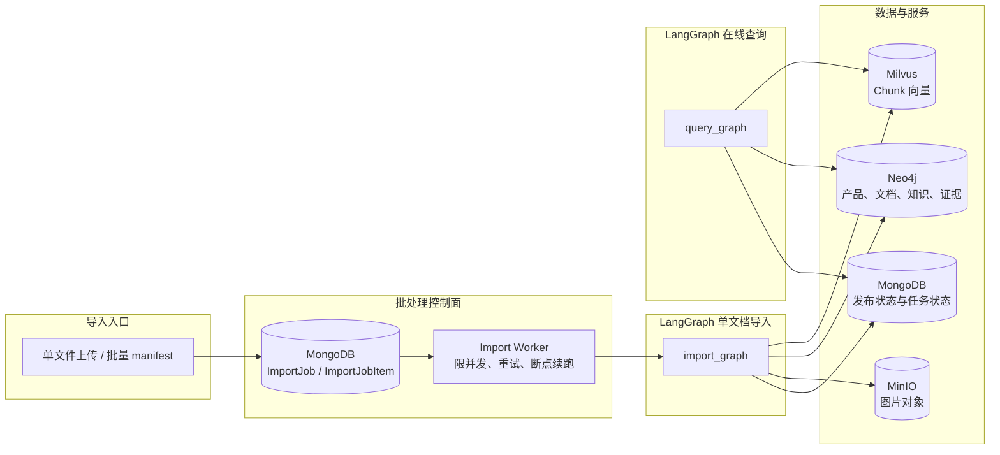
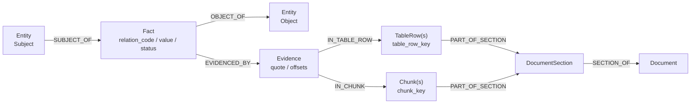
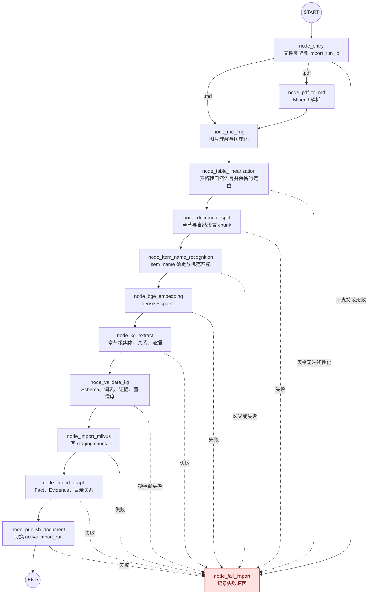
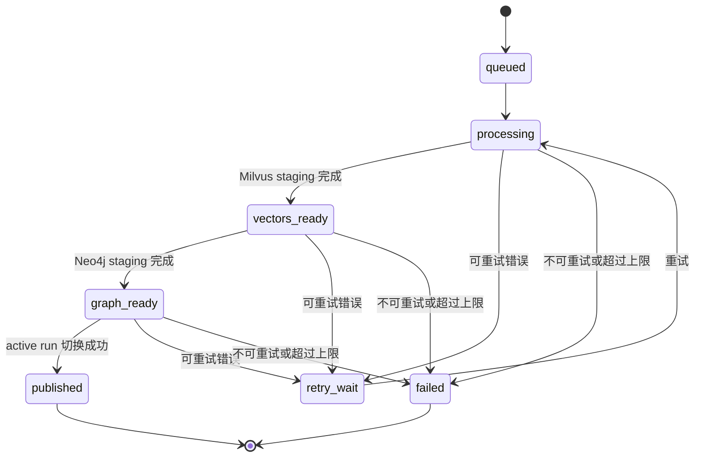
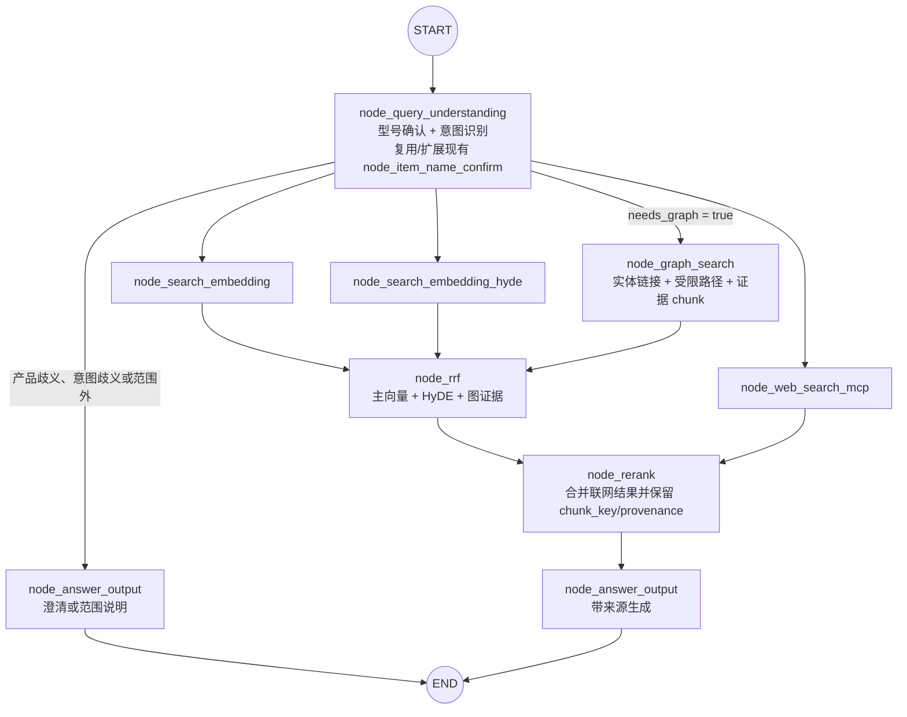

# ManualRAG 知识图谱模块粗粒度架构设计

- 状态：Draft（已完成架构评审）
- 日期：2026-11-09
- 适用范围：产品手册知识导入、图谱构建、在线检索与评测
- 领域术语：[GLOSSARY.md](../GLOSSARY.md)

本文定义知识图谱模块的粗粒度架构、边界和关键数据流。具体 Prompt、Schema 字段、阈值、索引、运维参数和接口契约留待详细 spec。

## 1. 目标与边界

### 1.1 目标

1. 在现有“型号确认 + 向量检索 + 精排 + 生成”链路上增加实体关系抽取、Neo4j 图构建和图证据召回。
2. 由 LangGraph 同时编排单文档知识导入和在线图谱召回。
3. 每条进入在线回答的图谱事实必须能够追溯到 `document -> section -> chunk -> evidence`。
4. 同一产品存在多份手册且事实冲突时，保留全部来源，不自动选择“最新版本”。
5. 使用可重复的 baseline、gold set、RAGAS 和图谱专用指标验证图谱是否真正改善回答。

### 1.2 非目标

- 不建设开放域知识图谱，不引入手册之外的公共知识。
- 不以全局摘要、跨品牌自动推理或通用多跳问答作为 MVP 目标。
- 不支持一份逻辑文档同时对应多个产品型号。多型号合订文件必须在导入前拆分为多个文档，否则进入人工审核或失败流程。
- 不为文档建立独立版本实体，不根据导入时间自动裁决事实新旧。
- 不在首版引入 Neo4j 集群、Enterprise、Aura、Kafka、Redis 或 Celery。
- 不在单文档内部并行执行 embedding 与知识抽取；并发放在多文档批处理层。
- 不把未通过校验或没有原文证据的关系送入生成模型。

## 2. 现状与设计约束

现有系统包含两条独立链路：

- 导入链路：PDF/Markdown -> 图片理解 -> 表格线性化 -> 标题与自然语言切分 -> `item_name` 识别 -> BGE-M3 向量化 -> Milvus。
- 查询链路：型号确认 -> 主向量检索、HyDE、联网搜索 -> 两路 RRF -> rerank -> 答案生成。

图谱模块必须同时修复以下前置问题：

1. 当前 chunk 使用 Milvus 自动生成的 `chunk_id`，导入节点没有回填 ID；图证据不能引用这种会漂移的标识。
2. 当前重导入按 `item_name` 删除整个产品下的切片，无法保留同产品的多份文档。
3. 当前 rerank 会丢弃 `chunk_id`、`parent_title` 和来源信息，无法稳定融合图结果。
4. 当前导入任务状态存在进程内字典，不能满足 4,000–5,000 份文档的断点续跑。
5. 当前仓库没有自动化测试、RAGAS 评测或检索质量门禁。
6. 当前切分未保护 Markdown 表格，超长参数表可能被从行中间截断。
7. 当前 `item_name` 可能来自模型输出或文件名回退，导入前缺少规范化与歧义校验。

## 3. 总体架构



职责划分：

| 层 | 职责 |
|---|---|
| 上传 API | 接收单文件或批量 manifest，创建持久化任务 |
| Import Worker | 调度文档、控制并发、重试失败项；不实现单文档业务规则 |
| LangGraph `import_graph` | 编排单文档解析、切分、向量化、知识抽取、写入和发布 |
| LangGraph `query_graph` | 编排型号确认、意图识别、多路召回、融合、精排和生成 |
| Milvus | 保存可检索的细粒度 chunk 和 embedding |
| Neo4j | 保存产品目录、文档结构、领域实体、Fact 和证据引用 |
| MongoDB | 保存批任务、发布状态和会话历史 |
| MinIO | 保存手册图片 |

## 4. 领域模型与图模型

### 4.1 三层模型

#### 产品目录层

- `Brand`
- `ProductCategory`
- `ProductSeries`
- `ProductModel`

产品目录主要来自文档标题、文件名和规范产品名 `item_name`。品牌、类别和系列允许跨文档共享；`ProductModel` 以规范产品名 `item_name` 为唯一身份，不额外引入产品主键。

一份 `Document` 只能对应一个 `ProductModel` 和一个 `item_name`。多型号合订文件必须在进入 `import_graph` 前拆分为多个文档；无法拆分时导入失败或进入人工审核，不按多产品文档发布。

#### 文档证据层

- `Document`
- `ImportRun`
- `DocumentSection`
- `Chunk`
- `TableRow`
- `Evidence`

该层只负责身份、发布状态和原文溯源，不作为开放式知识推理对象。

#### 手册知识层

- `Component`
- `ConsumableAccessory`
- `Procedure`
- `Symptom`
- `ErrorCode`
- `Parameter`
- `SafetyRisk`

知识实体默认在 `item_name` 范围内唯一。只有手册明确声明跨产品适用时，才通过 `APPLICABLE_TO` 扩展使用范围，不按同名自动跨产品合并。

### 4.2 标识规则

| 标识 | 规则 | 用途 |
|---|---|---|
| `item_name` | 已确认的规范产品名，一份文档只能有一个 | 产品身份、Milvus 过滤、知识实体作用域 |
| `document_id` | manifest 提供或在首次导入时由系统签发并持久化；不从标题或 `item_name` 推导 | 标识逻辑文档，不表示版本 |
| `content_hash` | 文件内容哈希 | 检测重复文件与完整性，不建模版本 |
| `revision_label` | 从标题提取的 `V1.02`、`ver02.30` 等文本 | 展示和冲突说明，不参与版本裁决 |
| `import_run_id` | 每次导入运行生成 UUID | 隔离 staging 数据、发布和回滚 |
| `section_key` | 文档内稳定标题路径 + 序号 | 章节身份 |
| `chunk_key` | `uuid5(document_id + import_run_id + section_key + ordinal)` | 检索、RRF 去重和图证据引用 |
| `table_row_key` | `uuid5(document_id + import_run_id + table_id + row_ordinal)` | 表格行定位与 Evidence 回溯 |
| `entity_key` | 实体类型 + 作用域 + 规范化名称 | 实体唯一身份 |
| `value_fingerprint` | 规范化后的值、单位、条件与限定语的稳定摘要；无取值时为空 | 区分参数事实的不同取值 |
| `fact_id` | `uuid5(subject_entity_key + relation_code + object_entity_key + value_fingerprint)` | 同一语义事实的规范化身份 |

Milvus 自动生成的 `chunk_id` 仅作为存储层主键，不作为跨系统业务标识。

`section_key` 是文档内的逻辑章节键；Neo4j 中 `DocumentSection` 的唯一范围为 `document_id + import_run_id + section_key`。同一文档的多个 ImportRun 不得复用同一个章节节点。

### 4.3 文档发布模型

同一 `document_id` 可以存在多个 `ImportRun`：

- `staging`：正在构建，不参与在线检索。
- `ready`：Milvus 和 Neo4j 均已成功写入。
- `published`：当前 active run。
- `failed`：构建或发布失败。
- `superseded`：已被后续成功 run 替换，等待清理。

同一 `item_name` 可以对应多份 `published` 的 `Document`。查询会聚合这些文档返回的关系与证据。

MongoDB 中每个 `Document` 保存 `active_import_run_id`。新 ImportRun 的 Milvus 和 Neo4j 数据均进入 `ready` 后，才切换该指针。查询开始时一次性读取相关文档的 active run ID 集合并保存为 `retrieval_snapshot_run_ids`；Milvus 和 Neo4j 均使用这组 ID 过滤，避免一次查询混用多个发布版本。

### 4.4 Fact 与 Evidence

语义关系采用 Fact 节点重建模：



约束：

- `Fact` 保存 `value`、`unit`、`qualifier` 和 `value_fingerprint`；普通无取值关系将这些字段留空。
- 同一 `subject + relation_code + object + value_fingerprint` 只保留一个 Fact；多个 chunk、表格行或多个文档的证据连接到同一 Fact。
- Fact 的状态为 `pending`、`accepted`、`review_required`、`rejected`、`conflict`。
- 一条 Evidence 可以连接一个或多个 Chunk 和一个或多个 TableRow，并保存来源 `document_id`、`import_run_id`、原文引文、偏移量和置信度。
- 在线检索只使用同时满足“Fact accepted”和“至少一条 active 文档证据”的事实。
- 跨文档的不同事实值不把 Fact 改为 `conflict`；这些 Fact 可以保持 `accepted`，通过不包含 `value_fingerprint` 的相同 `conflict_group_id` 标记并全部进入回答上下文。`Fact.status=conflict` 只表示单次抽取内部存在无法消解的冲突，默认不进入在线回答。
- 删除某个 `ImportRun` 时删除其 Evidence、Chunk、TableRow 和 DocumentSection；无剩余证据的孤立 Fact 再异步清理。

### 4.5 受控关系词表

| `relation_code` | 中文标签 | 合法主体 | 合法客体 |
|---|---|---|---|
| `BELONGS_TO_BRAND` | 属于品牌 | ProductModel | Brand |
| `BELONGS_TO_CATEGORY` | 属于类别 | ProductModel / ProductSeries | ProductCategory |
| `BELONGS_TO_SERIES` | 属于系列 | ProductModel | ProductSeries |
| `HAS_COMPONENT` | 包含部件 | ProductModel | Component |
| `HAS_CONSUMABLE` | 使用耗材或配件 | ProductModel | ConsumableAccessory |
| `COMPATIBLE_WITH` | 兼容 | ProductModel / ConsumableAccessory | ProductModel / Component |
| `HAS_SYMPTOM` | 表现出故障现象 | ProductModel / Component | Symptom |
| `CAUSED_BY` | 由以下原因导致 | Symptom / ErrorCode | Component / Parameter / SafetyRisk |
| `RESOLVED_BY` | 通过以下步骤处理 | Symptom / ErrorCode | Procedure |
| `REQUIRES` | 需要 | Procedure | Component / ConsumableAccessory / Parameter |
| `PRECEDES` | 先于 | Procedure | Procedure |
| `HAS_PARAMETER` | 具有参数 | ProductModel / Component / Procedure | Parameter |
| `HAS_RISK` | 存在安全风险 | ProductModel / Procedure | SafetyRisk |
| `PROHIBITS` | 禁止 | ProductModel / Procedure | Procedure / ConsumableAccessory |
| `RECOMMENDS` | 推荐 | ProductModel / Procedure | Procedure / ConsumableAccessory |
| `APPLICABLE_TO` | 适用于 | Component / ConsumableAccessory / Parameter / Procedure | ProductModel |
| `MENTIONED_IN` | 被文档提及 | Entity / Fact | DocumentSection / Chunk / TableRow |

`MENTIONED_IN` 用于补充溯源，不参与语义扩展路径。关系扩展只允许详细 spec 中显式配置的路径。

### 4.6 中文和英文命名

- Neo4j label、属性名、物理关系名使用英文。
- 实体规范名称、别名、章节标题、证据原文使用中文。
- 业务语义关系使用 `relation_code` 和 `relation_label_zh` 双字段。
- API 和前端展示中文标签，存储与评测使用稳定代码。

## 5. 知识导入链路

### 5.1 批处理与 LangGraph 的边界

`Import Worker` 负责：

- 读取 manifest。
- 生成和维护 `ImportJob`、`ImportJobItem`。
- 控制多文档并发。
- 重试超时和瞬时错误。
- 从持久化阶段状态恢复未完成任务。

LangGraph `import_graph` 只负责一份文档内部的确定性流程。当前单文档执行顺序为：

```text
表格线性化 -> 自然语言切分 -> item_name 确认 -> 向量化 -> 图谱抽取与校验 -> Milvus 写入 -> Neo4j 写入 -> 发布
```

### 5.2 单文档导入 LangGraph



失败边用于表达状态转换；具体实现可使用 LangGraph 条件边或节点内结构化异常，详细 spec 再固定。

### 5.3 节点职责

| 节点 | 输入 | 输出 | 说明 |
|---|---|---|---|
| `node_entry` | 文件路径、manifest 元数据 | `import_run_id`、文件类型 | 不再以文件名作为唯一身份 |
| `node_pdf_to_md` | PDF | Markdown、图片、版面产物 | 延续现有 MinerU 流程 |
| `node_md_img` | Markdown、图片 | 图片摘要、MinIO URL | 图片摘要继续进入正文 |
| `node_table_linearization` | 含表格的 Markdown | 线性化 Markdown、`TableRow` 元数据 | 表格行转换为自然语言，并保留 `table_id`、`row_id` 与原始单元格 |
| `node_document_split` | 线性化 Markdown | `DocumentSection`、chunk 草稿 | 按自然语言和标题切分；chunk 保留关联的 `table_row_key` |
| `node_item_name_recognition` | 文档内容、manifest 提示 | `item_name`、`document_id`、`chunk_key`、置信度 | 一份文档只允许一个 `item_name`；歧义或未拆分多型号文档不得发布，且此节点不写 `kb_item_names` |
| `node_bge_embedding` | chunk | dense/sparse 向量 | 保持 BGE-M3 |
| `node_kg_extract` | 父块、标题路径、`item_name` | 实体、Fact、证据候选 | 章节级抽取，不按孤立 chunk 抽取 |
| `node_validate_kg` | 抽取结果 | accepted/review/rejected Fact | 强制执行白名单和证据定位 |
| `node_import_milvus` | chunk、向量 | staging chunk | 写入 `item_name`、`document_id`、`import_run_id`、`chunk_key`、`revision_label` |
| `node_import_graph` | 校验后图谱数据 | Neo4j staging 数据 | 幂等 MERGE |
| `node_publish_document` | import run ID | active 文档 | 切换 `active_import_run_id`，写入 `kb_item_names`，并触发旧数据清理 |

`item_name` 规范规则：

- 先对模型候选和 manifest 提示做大小写、空白、标点和型号格式归一化，再与 `kb_item_names` 中的现有 `item_name` 精确匹配。
- 命中已有产品时使用目录中的规范拼写；未命中时只接受 manifest 明确给出的规范产品名，否则进入人工审核。
- 文件名回退不能作为产品身份直接发布。
- 已发布 `item_name` 的改名必须作为显式目录迁移处理，不能由后续导入自动覆盖。

### 5.4 表格线性化

表格不直接使用递归字符切分。处理步骤固定为：

1. 识别 Markdown 表格及其标题、表头和表体。
2. 展开或重复合并单元格的父级值。
3. 每一行转换为带表格上下文的自然语言，例如“表格 3，第 2 行：额定电压为 220 V。”
4. 为每行生成 `table_row_key`，保留 `table_id`、行序号、原始单元格和源章节。
5. 线性化后的自然语言正文再进入 `node_document_split`，按现有自然语言切分规则生成 Chunk。

表格无法识别、行列关系不完整、单元格丢失或无法展开时，记录结构化错误并使导入失败或进入审核；不允许静默丢弃表格。

### 5.5 实体关系抽取

抽取流程：

1. 以标题父块为单元，附带 `document_id`、`item_name`、标题路径和相邻章节摘要。
2. LLM 输出实体、关系、证据原文、证据位置提示和置信度。
3. 规则层执行关系白名单、类型约束、实体规范化和证据定位。
4. 证据定位允许一条 Evidence 覆盖一个或多个 Chunk 和表格行；所有定位结果必须来自同一 `document_id` 和 `import_run_id`。
5. 同一 Fact 合并多条证据，不复制事实。
6. 低于阈值、类型冲突、证据缺失或关系歧义进入待审核状态。
7. 无法解析 JSON、模型超时或超过重试上限时记录结构化错误并使导入失败。

章节筛选策略：

- 20 份试点对全部非空章节执行抽取。
- 封皮、目录、版权页可由确定性规则记录 `skip_reason` 后跳过。
- 只有试点证明不会漏掉关键事实后，才允许扩大到 4,000–5,000 份文档的预筛选。

### 5.6 批量导入状态



`vectors_ready` 和 `graph_ready` 数据处于 staging，不能进入在线检索。发布前保留旧 active run；新 run 全部成功后再切换。

## 6. 在线查询链路

### 6.1 查询 LangGraph



`node_query_understanding` 是本架构中的逻辑名称。首版可以继续使用现有 `node_item_name_confirm`，并在同一次 LLM 调用中返回意图字段，避免增加额外调用。

主向量检索和 HyDE 检索始终执行；`needs_graph` 只控制是否增加 `node_graph_search`，不能用它关闭基础 RAG 链路。
`needs_graph=false` 时 `graph_candidates` 为空，RRF 仍使用主向量和 HyDE 结果继续执行；`needs_graph=true` 时再把图证据作为第三路候选加入。

### 6.2 查询理解与意图识别

查询理解输出至少包含：

```json
{
  "rewritten_query": "华为擎云 W515x 开机后无法联网",
  "item_names": ["华为擎云 W515x"],
  "intent_status": "OK",
  "primary_intent": "FAULT_CAUSE",
  "auxiliary_intents": ["INSTALL_CONNECT"],
  "needs_graph": true,
  "query_entities": [
    {
      "name": "无法联网",
      "type_hint": "Symptom"
    }
  ],
  "confidence": 0.86,
  "clarification_question": ""
}
```

约束：

- `intent_status` 只能是 `OK`、`AMBIGUOUS`、`OUT_OF_SCOPE`。
- `primary_intent` 来自 10 项业务意图；`auxiliary_intents` 最多两项。
- 超过两个辅助意图、主意图置信度不足或问题范围无法确定时，设置 `AMBIGUOUS`。
- `needs_graph` 表示问题是否存在明确的关系检索需求，不等同于“问题属于产品手册”。
- `query_entities.type_hint` 只能使用知识层实体类型；最终类型以规则校验和图谱查询为准。
- LLM 只生成候选实体名称和类型提示，不能直接生成实体 ID、Fact ID 或 Cypher。

### 6.3 10 项意图与查询路径

| 意图 | 默认图路径 |
|---|---|
| `PRODUCT_RELATION` | ProductModel -> series -> category，ProductModel -> brand |
| `PARAMETER_SPEC` | ProductModel/Component/Procedure -> HAS_PARAMETER -> Parameter |
| `SAFETY_COMPLIANCE` | ProductModel/Procedure -> HAS_RISK/PROHIBITS -> SafetyRisk/Procedure |
| `INSTALL_CONNECT` | Procedure -> APPLICABLE_TO -> ProductModel，Procedure -> REQUIRES -> Component |
| `OPERATION_GUIDE` | Procedure -> APPLICABLE_TO -> ProductModel，Procedure -> REQUIRES -> Component/ConsumableAccessory |
| `MAINTENANCE_CONSUMABLE` | ProductModel -> HAS_CONSUMABLE/REQUIRES -> ConsumableAccessory/Procedure |
| `FAULT_CAUSE` | Symptom/ErrorCode -> CAUSED_BY -> Component/Parameter/SafetyRisk |
| `FAULT_RESOLUTION` | Symptom/ErrorCode -> RESOLVED_BY -> Procedure |
| `PROCEDURE_DEPENDENCY` | Procedure -> PRECEDES/REQUIRES -> Procedure/Component/ConsumableAccessory |
| `APPLICABILITY_COMPATIBILITY` | Component/ConsumableAccessory/Parameter/Procedure -> APPLICABLE_TO -> ProductModel，以及 COMPATIBLE_WITH |

所有路径最多遍历两个 Fact 跳，不允许无边界 `shortestPath` 或全图扫描。

### 6.4 意图模糊与兜底

MVP 采用两轮交互：

1. `intent_status=AMBIGUOUS` 时生成一个澄清问题，结束本轮，不执行检索。
2. 用户下一轮回答后，携带最近会话历史重新执行查询理解。
3. 用户明确要求“按所有可能情况查找”时，运行十类受控路径模板的 bounded fallback。
4. Fallback 仍受两个 Fact 跳、路径数、候选实体数和证据 chunk 数上限约束，并标记 `fallback_scope=all_intents`。

首版不使用 LangGraph `interrupt()` 和 checkpoint resume；若后续需要真正的图内暂停/恢复，再单独设计查询状态持久化。

### 6.5 实体链接

实体链接顺序：

1. 用已确认的 `item_name` 限定产品范围。
2. 对 `query_entities` 执行规范化名称和别名精确匹配。
3. 对剩余候选执行 Neo4j full-text 搜索。
4. 出现多个高分候选时记录歧义，不随机选择。
5. 仍未命中时记录 `graph_status=no_match`，不使用 embedding 相似度强行链接。

实体别名只来自文件名、规范产品名、手册明确写出的别名或人工维护数据。

### 6.6 图召回输出

`node_graph_search` 只输出有 `accepted` Fact 支撑的证据 chunk：

```json
{
  "chunk_key": "...",
  "graph_score": 0.82,
  "matched_fact_ids": ["..."],
  "path_summary": ["..."],
  "provenance": {
    "document_ids": ["..."],
    "section_keys": ["..."],
    "evidence_ids": ["..."],
    "table_row_keys": ["..."]
  },
  "graph_status": "ok"
}
```

原始 Fact 和路径摘要不能绕过证据 chunk 直接成为生成上下文。

同一 Fact 的 Evidence 包含多个 Chunk 时，图召回按 Chunk 输出多个候选，并用 `chunk_key` 去重；表格来源继续保留 `table_row_keys` 以便回溯到线性化前的行。

### 6.7 融合、精排与生成

- 主向量和 HyDE 的 Milvus 过滤条件包含已确认 `item_name` 及 `retrieval_snapshot_run_ids`；图查询同样只读取该快照中的 active run。
- `node_rrf` 接收主向量、HyDE 和图证据三个排名列表。
- 三路初始权重均为 `1.0`，保留为配置项。
- 使用 `chunk_key` 去重；同一 chunk 合并所有路径和来源信息。
- RRF 公式保持 `score = sum(weight / (rank + k))`，首版 `k=60`、Top 5。
- 联网结果在 RRF 后与本地候选合并，统一进入 reranker。
- reranker 必须保留 `chunk_key`、`type`、`matched_fact_ids` 和 provenance。
- 生成 prompt 增加来源类型：`向量查询`、`图谱证据`、`网络搜索`。
- 同一关系出现多个冲突值时，prompt 必须展示文档标题、`revision_label` 和证据差异，不得自动选择。

## 7. 一致性与失败语义

### 7.1 导入失败

- 任一关键阶段失败时，`ImportRun` 不进入 `published`。
- 已写入的 staging 数据保留用于诊断和重试，但不能被查询。
- `kb_item_names` 只在发布阶段写入或更新；发布失败时不能提前把产品名暴露给在线型号确认。
- 任务记录保存阶段、节点、异常类型、重试次数和脱敏后的错误摘要。
- 不允许把知识抽取失败后的文档静默当作“纯向量文档”发布。

### 7.2 查询失败

| 状态 | 行为 |
|---|---|
| `graph_status=no_match` | 正常状态；由图无命中，向量结果继续参与回答 |
| `graph_status=timeout` | 记录错误并告警；有其他有效证据时返回显式 degraded 结果 |
| `graph_status=unavailable` | 记录错误并告警；有其他有效证据时返回显式 degraded 结果 |
| 图是唯一必要证据且无有效向量结果 | 返回可解释的失败或稍后重试，不生成无依据答案 |

degraded 状态必须进入响应元数据和日志，不能只在代码注释中说明。

### 7.3 重导入与清理

1. 同一个 `document_id` 同时只允许一个正在构建的 ImportRun，使用 MongoDB 原子更新占用导入权。
2. 新 ImportRun 使用新的 staging 数据构建。
3. 旧 published ImportRun 在构建期间继续提供查询。
4. 新 run 的 Milvus 和 Neo4j 写入均成功后，写入 `kb_item_names` 并切换 `active_import_run_id`。
5. 每次查询开始时读取 active run ID 集合，保存为 `retrieval_snapshot_run_ids`；本次查询的 Milvus 和 Neo4j 检索必须共用该集合。
6. 旧 run 标记为 `superseded`，在查询宽限期后异步清理 Milvus chunk、Neo4j Evidence/Chunk/TableRow/DocumentSection 和本次 run 不再引用的 MinIO 对象。
7. 清理失败不回滚已发布的新 run，但必须进入可重试清理任务并告警。

## 8. 评测设计

### 8.1 数据分层

- Silver set：由 LLM 从 `DocumentSection + Chunk` 生成，用于快速迭代。
- Gold set：人工确认 `question`、`ground_truth`、来源文档、gold context、实体和关系。

金标字段至少包括：

```text
question_id
question
question_type
primary_intent
auxiliary_intents
item_name
source_document_ids
gold_chunk_keys
expected_entities
expected_relations
gold_contexts
ground_truth
```

### 8.2 20 份文档试点

文档选择采用覆盖矩阵，不随机抽取：

- 平板
- 笔记本/台式机
- 显示器
- 打印机
- 路由器/网关
- 工业或专用设备

同时覆盖单型号多文档、参数表密集、安全警示密集、错误码表密集、带修订标签标题和跨产品说明。多型号合订文件不在试点范围内，必须预先拆分。

问题规模目标：

- 10 项意图各至少 5 条：不少于 50 条。
- 普通事实和非图谱对照题约 20 条。
- 第一版 gold set 约 70 条。

### 8.3 指标

RAGAS：

- `faithfulness`
- `answer_correctness`
- `context_precision`
- `context_recall`

图谱专用：

- 实体链接召回率
- 关系 Recall@K
- 路径 Recall@K
- 证据 chunk 命中率
- 无证据关系进入答案的比例

工程指标：

- 抽取失败率
- 导入耗时
- 查询 P95 延迟
- 首 token 时间 `time_to_first_token`
- LLM 输出吞吐率 `output_tokens_per_second`
- 每次请求输入/输出 token 数

### 8.4 对照和门禁

1. 先在当前链路运行原向量 RAG，形成 baseline。
2. 完成文档身份、active run 和表格线性化后重跑 parity baseline，确认非图谱业务没有回退。
3. 再运行图谱增强链路。
4. 分别比较 10 类意图和普通对照题。
5. 初版目标为关系型问题的检索或答案指标相对提升不低于 15%，P95 延迟增量不超过 1 秒。
6. 阈值需在 baseline 完成后重新标定。

## 9. 建议模块边界

建议新增或重构：

```text
app/
├── kg/
│   ├── schema.py              # 实体、关系、Fact、状态枚举
│   ├── identity.py            # document_id / chunk_key / table_row_key / fact_id
│   ├── table_linearization.py # Markdown 表格转自然语言与行定位
│   ├── extraction.py          # 章节级 LLM 抽取接口
│   ├── validation.py          # Schema、词表、证据校验
│   └── query_planning.py      # 意图到受限路径模板的映射
├── clients/
│   ├── neo4j_utils.py         # 连接、约束、事务、查询
│   └── import_job_utils.py    # MongoDB 批任务持久化
├── import_process/agent/nodes/
│   ├── node_table_linearization.py
│   ├── node_kg_extract.py
│   ├── node_validate_kg.py
│   ├── node_import_graph.py
│   └── node_publish_document.py
└── query_process/agent/nodes/
    └── node_graph_search.py
```

首版 LangGraph State 需要新增：

- 导入：`document_id`、`content_hash`、`revision_label`、`import_run_id`、`linearized_md`、`table_rows`、`sections`、`kg_candidates`、`validated_facts`、`publication_status`。
- 查询：`intent_status`、`primary_intent`、`auxiliary_intents`、`needs_graph`、`query_entities`、`retrieval_snapshot_run_ids`、`graph_candidates`、`graph_status`、`retrieval_metadata`。

## 10. 部署与依赖边界

- 新增自托管 Neo4j Community，纳入现有 Docker Compose 管理。
- Neo4j 使用独立认证配置和环境变量；不得把凭据写入代码、日志或文档。
- Python 侧使用 Neo4j 官方 driver。
- 批任务复用现有 MongoDB，新增 collection 和索引。
- RAGAS 作为评测依赖引入，不与在线服务运行路径耦合。
- 具体 Neo4j LTS 版本、资源限额、备份恢复、索引和账号权限在详细 spec 中固定。

## 11. 实施阶段

### Phase 0：基线

- 确定 20 份覆盖矩阵文档。
- 建立约 70 条 silver/gold 数据和 RAGAS 基线。
- 统计导入成本、token 使用和延迟。

### Phase 1：身份与发布基础

- 引入 `document_id`、`chunk_key`、`import_run_id`。
- 修复按 `item_name` 删除全部切片的问题。
- 引入 Mongo 持久化批任务与 staging/published 状态。
- 完成表格线性化、`TableRow` 定位和自然语言切分。
- 引入 `active_import_run_id` 与查询级 `retrieval_snapshot_run_ids`，把 `kb_item_names` 写入延后到发布阶段。
- 在当前 baseline 上重跑 parity baseline。

### Phase 2：20 份文档的端到端图谱

- LangGraph 增加抽取、校验、Neo4j 写入和发布节点。
- 完成 Neo4j 三层模型、Fact/Evidence 和状态机。
- 完成参数 Fact 的 `value_fingerprint` 与多 Chunk/表格行 Evidence 回溯。
- 完成 20 份文档的全章节抽取与金标校准。

### Phase 3：在线图召回

- 查询理解增加 10 项意图、`needs_graph` 和 `query_entities`。
- 增加 `node_graph_search`、三路 RRF 和图 provenance。
- 完成降级、冲突展示和指标对比。

### Phase 4：批量扩展

- 基于试点结果标定置信阈值、路径上限、RRF 权重和章节筛选规则。
- 扩展到 4,000–5,000 份文档。
- 完成备份、告警、清理任务和运维手册。

## 12. 风险与详细 spec 待决项

| 风险或待定项 | 需要在详细 spec 中解决的问题 |
|---|---|
| 中文全文检索 | 验证 Neo4j full-text 的中文分词、别名索引和召回效果 |
| LLM 抽取稳定性 | 固定 JSON Schema、重试策略、Prompt 版本和失败分类 |
| `item_name` 身份 | 明确规范化算法、别名来源、人工审核规则；已发布的 `item_name` 不得自动改名 |
| 文档身份 | 明确 manifest 的稳定来源键，以及交互式上传时 `document_id` 的签发和重复检测规则 |
| 事实冲突 | 定义 `value_fingerprint`、冲突分组、展示模板和审核状态转换 |
| 表格线性化 | 覆盖多行表头、合并单元格、空单元格和超长单元格，并建立表格行到 Chunk 的可验证映射 |
| 章节过长 | 定义按子标题/窗口切分、父上下文注入和事实合并规则 |
| 批量成本 | 用 20 份文档测量每份 token、调用次数、耗时和失败率 |
| 跨存储一致性 | 固定 active run 切换、查询快照和清理宽限期的具体实现 |
| 图查询上限 | 标定路径数、出度、候选实体、证据 chunk 和超时 |
| 排序参数 | 标定三路 RRF 权重、动态 TopK 和图路径评分 |
| 冲突与消歧 | 明确产品、实体和意图冲突在用户交互中的统一表达 |
| 数据库运维 | 确定 Neo4j LTS、认证、备份、恢复、容量和监控 |
| 评测偏差 | 避免同一模型既生成 silver set 又单独充当最终裁判 |

## 13. 本阶段结论

该模块不是简单的“给 Milvus 增加一张实体表”，而是一次跨导入、查询、数据身份和评测的架构扩展。首版必须先建立可发布、可追溯、可回滚的数据边界，再在 20 份代表性文档上验证图谱收益；在 baseline 和 gold set 完成前，不直接扩大到全部语料。
