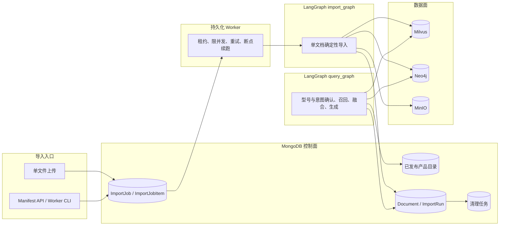
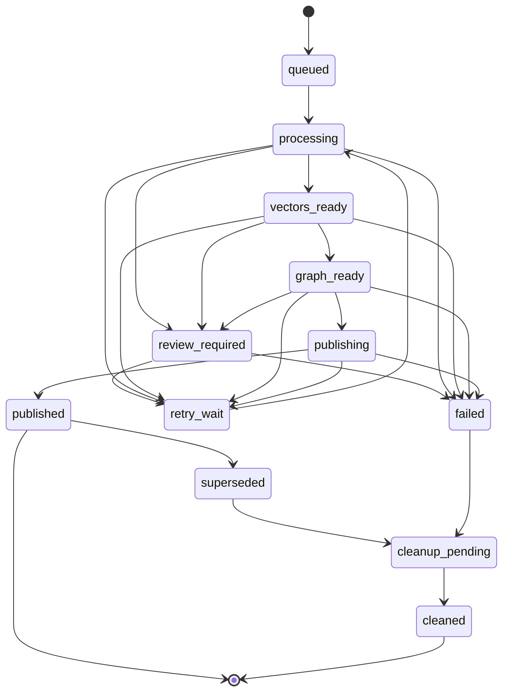

# ManualRAG 全局知识图谱实现 Spec

- 状态：Ready for implementation
- 日期：2026-11-09
- 适用范围：现有产品手册 RAG、知识导入、图谱构建、在线检索、评测、部署与运维
- 领域术语：[GLOSSARY.md](../GLOSSARY.md)
- 粗粒度架构：[knowledge-graph-architecture.md](knowledge-graph-architecture.md)
- 当前实现说明：[ARCHITECTURE.md](../ARCHITECTURE.md)

本 spec 将粗粒度架构落实为跨导入、查询、存储、接口、测试与部署的全局实现契约。本文中的
“必须”“不得”“只允许”均为验收约束；未明确规定的阈值和性能参数由 `app/conf/` 下的配置对象提供，
代码中不得散落未命名的魔法值。

## Problem Statement

当前系统已经能够完成“型号确认 + 向量检索 + 精排 + 生成”，但它只能证明某个切片在文本上相似，
无法稳定表达产品、部件、故障、步骤、参数之间的语义关系，也无法保证回答中的图谱事实可以追溯到
具体文档、章节、切片、表格行和原文证据。

现有实现进一步存在以下会阻断图谱落地的问题：

1. Milvus 中的 `chunk_id` 由存储层自动生成，导入节点没有回填稳定业务标识，图证据无法可靠引用。
2. 重新导入时按 `item_name` 删除该产品下的全部切片，无法保留同一产品的多份文档。
3. RRF 和 rerank 会丢弃 `chunk_key`、父标题、文档来源和事实来源，图候选无法与向量候选稳定融合。
4. 导入任务、节点进度和 SSE 队列保存在进程内，4000–5000 份文档无法断点续跑。
5. 表格可能从行中间被切断，表头、合并单元格和原始行定位丢失。
6. `item_name` 可能由模型生成或回退到文件名，未发布内容可能提前进入在线型号确认。
7. 仓库没有正式自动化测试、RAGAS 评测、质量门禁和可重复的 baseline。
8. 多条事实冲突时，系统没有稳定的冲突分组、来源保留和回答展示协议。

## Solution

建立由 MongoDB 控制面、Neo4j 图谱知识面、Milvus 向量检索面、MinIO 对象存储面和两条 LangGraph
工作流组成的全局架构：

1. MongoDB 保存已发布产品目录、文档注册、批任务、ImportRun、发布指针和清理任务，是控制面事实来源。
2. Neo4j Community 5.26 LTS 保存产品目录投影、文档结构、领域实体、Fact 和 Evidence。
3. Milvus 保存可重建的 Chunk 与产品名向量索引，不作为产品身份或发布状态的权威来源。
4. MinIO 按 `document_id/import_run_id` 保存隔离的图片与解析产物。
5. 导入先写 staging，再通过 Mongo 指针切换发布；查询开始时固化的
   `retrieval_snapshot_run_ids` 同时约束 Milvus 与 Neo4j。
6. 在线查询只把有 `accepted` Fact 和 active 文档证据支撑的 Chunk 作为图证据，同时保留所有冲突来源。
7. 通过 20 份覆盖矩阵文档、约 70 条 gold set、RAGAS 和图谱专用指标验证收益，再扩大批量。

## 用户故事

1. 作为产品手册用户，我希望系统先确认具体产品型号，再进行检索，以免同系列其他型号的手册污染答案。
2. 作为产品手册用户，我希望系统能回答“故障现象由什么引起”，并能说明对应部件、参数或安全风险。
3. 作为产品手册用户，我希望系统能回答“错误码如何解决”，并返回手册中的处理步骤。
4. 作为产品手册用户，我希望系统能回答部件、耗材或操作步骤适用于哪些型号，以免误用不兼容内容。
5. 作为产品手册用户，我希望系统能回答安装、维护和操作步骤的前后依赖关系。
6. 作为产品手册用户，我希望系统能准确返回参数、单位和使用条件，不把不同条件下的值混在一起。
7. 作为产品手册用户，我希望系统在参数冲突时展示全部文档来源和修订标签，而不是擅自选择“最新”值。
8. 作为产品手册用户，我希望答案中的每条图谱来源都可以回溯到手册原文。
9. 作为产品手册用户，我希望在问题的型号或意图不明确时收到一个具体的澄清问题，而不是得到猜测答案。
10. 作为产品手册用户，我希望图谱服务超时时得到明确标记的降级答案，而不是无提示地退化。
11. 作为产品手册用户，我希望系统在没有足够证据时明确说明无法回答，而不是生成无依据内容。
12. 作为产品手册用户，我希望问题很明确时不额外触发图谱检索，以减少等待时间。
13. 作为产品手册用户，我希望能在同一产品存在多份手册时获得跨文档的完整证据集合。
14. 作为产品手册用户，我希望图片摘要仍能通过现有向量链路被检索并随答案返回。
15. 作为产品手册用户，我希望表格参数和错误码不会因为切分而失去表头或行上下文。
16. 作为内容运营人员，我希望同一产品可以发布多份手册，并能分别重导入和清理。
17. 作为内容运营人员，我希望新导入在全部存储成功前对在线查询不可见。
18. 作为内容运营人员，我希望发布失败时旧数据继续服务，不出现半发布状态。
19. 作为内容运营人员，我希望未在已发布产品目录中的 `item_name` 不会进入在线型号确认。
20. 作为内容运营人员，我希望多型号合订文件在导入前被拦截，而不是被错误归到一个产品。
21. 作为内容运营人员，我希望有问题的表格、图片或抽取结果给出结构化失败原因，并允许重试。
22. 作为内容运营人员，我希望同一文件重复上传时得到一个明确的 no-op 结果，而不是生成重复文档。
23. 作为内容运营人员，我希望通过 manifest 一次提交数千份文档，并能监控每个文档的阶段和失败原因。
24. 作为内容运营人员，我希望失败项可以单独重试，不影响已经成功的文档。
25. 作为内容运营人员，我希望 worker 重启后能从 Mongo 中的持久化阶段继续任务。
26. 作为内容审核人员，我希望看到低置信度、类型冲突或证据缺失的 Fact，并能将其审核为接受或拒绝。
27. 作为内容审核人员，我希望已发布 `item_name` 不会被后续导入自动改名。
28. 作为内容审核人员，我希望同一事实的多个来源被合并到同一个 Fact，而不是复制成多条事实。
29. 作为内容审核人员，我希望冲突值保留为多个相互关联的 Fact，并能按冲突组查看全部来源。
30. 作为研发人员，我希望 Chunk、TableRow、Entity、Fact 和 Evidence 的标识是确定性的，以便重试和比较。
31. 作为研发人员，我希望领域规则与 LangGraph 节点解耦，以便通过应用服务 seam 测试完整行为。
32. 作为研发人员，我希望 Milvus 和 Neo4j 中的数据可以由 Mongo 控制面状态重建，减少不可恢复的不一致。
33. 作为研发人员，我希望 LLM 只能输出受 Schema 约束的候选，不能直接生成实体 ID、Fact ID 或 Cypher。
34. 作为研发人员，我希望图查询使用受控路径模板，并设置跳数、路径数和候选数上限。
35. 作为研发人员，我希望 rerank 后仍保留候选的全部检索来源和 provenance。
36. 作为研发人员，我希望现有 `/upload`、`/status/{task_id}` 和 `/query` 的旧字段继续可用。
37. 作为评测人员，我希望 silver set 与 gold set 分开管理，并明确哪些答案已经人工确认。
38. 作为评测人员，我希望 baseline、parity baseline 和图谱增强结果使用相同数据集和配置。
39. 作为评测人员，我希望按 10 类意图和普通事实题分别报告 RAGAS、图谱和工程指标。
40. 作为评测人员，我希望没有证据的关系进入答案时被单独计数，而不能被普通答案正确率掩盖。
41. 作为运维人员，我希望 Neo4j 使用固定 LTS 镜像、独立凭据、健康检查和持久化卷。
42. 作为运维人员，我希望清理失败进入可重试任务并告警，不回滚已成功发布的新数据。
43. 作为运维人员，我希望能够备份和恢复 Neo4j，并在恢复后验证约束与索引。
44. 作为运维人员，我希望日志包含任务、文档、阶段、错误分类和耗时，但不包含凭据或完整环境配置。
45. 作为产品负责人，我希望只在 20 份代表文档证明收益后扩大全量，而不是先承担全部导入成本。

## 架构设计

### 总体组件



### 数据事实来源

| 数据 | 权威来源 | 派生副本 | 一致性要求 |
|---|---|---|---|
| `item_name`、别名、产品状态 | MongoDB `kg_products` | Neo4j `ProductModel`、Milvus `kb_item_names` | 产品必须 active，且至少有一份 active Document 才能被在线确认 |
| Document、ImportRun、发布指针 | MongoDB | Neo4j 中带相同标识的运行节点 | 查询只认 Mongo 中的 active run 快照 |
| 图谱实体、Fact、Evidence | Neo4j | 无 | 在线只读取有 active Evidence 的 `accepted` Fact |
| Chunk 检索内容与向量 | Milvus | 无 | 内容可由 DocumentSection 与原文重新生成 |
| 原始文件、图片和解析产物 | MinIO / 上传源 | Worker 临时目录 | 对象路径包含 `document_id` 与 `import_run_id` |
| 会话历史 | MongoDB `chat_message` | 无 | 与导入控制集合隔离 |

### 服务与进程边界

- 导入 API 只负责接收 manifest 或单文件、校验基本结构、创建持久化任务，不执行单文档业务。
- Import Worker 是独立进程，负责领取任务、限并发、心跳、重试和恢复。
- `import_graph` 只负责一份文档内部的有序处理。
- 查询 API 只负责请求校验、启动查询任务与输出协议。
- `query_graph` 负责型号、意图、路径、召回、融合与生成。
- `eval` runner 是离线命令，不进入在线服务依赖图。
- 首版不引入 Kafka、Redis、Celery、Neo4j 集群或跨服务分布式事务。

### 发布与一致性模型

同一 `document_id` 在任意时刻最多允许一个构建中的 ImportRun。发布遵循以下顺序：

1. Mongo 创建 ImportRun，状态为 `queued`。
2. Worker 使用 Mongo 原子条件更新领取任务并写入租约。
3. 解析、切分、产品名确认和向量化全部成功。
4. 使用新 `import_run_id` 写入 Milvus staging 数据，状态变为 `vectors_ready`。
5. 使用同一 `import_run_id` 写入 Neo4j staging 数据并完成引用完整性校验，状态变为 `graph_ready`。
6. 刷新或插入派生产品名索引后，Mongo 条件更新 `Document.active_import_run_id`。
7. 只有指针更新成功的 ImportRun 进入 `published`；旧 run 进入 `superseded`。
8. 查询开始时读取相关 Document 的 active run ID 集合，并在本次查询中固定为
   `retrieval_snapshot_run_ids`。
9. 旧 run 在宽限期后进入 `cleanup_pending`；清理任务幂等删除存储数据。

跨存储不承诺原子事务。发布原子性由 Mongo 单个 Document 的 `active_import_run_id` 切换定义；
Milvus 与 Neo4j 的 staging 数据只有在查询快照包含其 run ID 时才可见。

指针切换和 Run 终态更新不是同一个 Mongo 事务。若 worker 在二者之间崩溃，恢复逻辑以
`Document.active_import_run_id` 为准：指针已指向该 run 时，将 run 幂等收尾为 `published`；
指针未指向该 run 时，run 仍不可见，并按 `resume_stage` 重试或失败。

### 全局不变量

- 一份 Document 只能对应一个 `ProductModel` 和一个规范 `item_name`。
- 同一 `item_name` 可以对应多份已发布 Document。
- 不从标题、文件名或导入时间推导 `document_id`。
- 不以导入时间自动裁决事实新旧，不建立 Document 版本实体。
- 每条在线图谱事实必须能追溯到 active Document 下的 Evidence、Chunk 或 TableRow。
- LLM 只输出候选内容，不生成 ID、发布状态或 Cypher。
- 任何节点失败都要记录结构化错误；不得把失败静默降级为“纯向量文档”。
- 查询不得在一次请求内混用不同发布快照。

## 技术选型

| 层 | 选型 | 版本或约束 | 引入方式 |
|---|---|---|---|
| 运行时 | Python | 3.12，以上限锁定实际验证版本 | 修正当前不一致的 `requires-python` |
| 编排 | LangGraph `StateGraph` | 沿用现有 1.x 约束 | 已声明 |
| API | FastAPI + Uvicorn | 沿用现有版本范围 | 已声明 |
| 图谱数据库 | Neo4j Community LTS | `5.26.33`，standalone | Docker Compose |
| 图谱 driver | `neo4j` | 6.x，同步 driver | 新增运行时依赖 |
| 向量库 | Milvus | 沿用 `v3.0.0` standalone | 已部署 |
| 会话与控制面 | MongoDB | 沿用 `mongo:7` | 已部署 |
| 对象存储 | MinIO | 继续使用现有服务 | 已部署 |
| 向量模型 | BGE-M3 | dense 1024 + sparse | 沿用 |
| 精排模型 | BGE-reranker-large | 沿用现有 512 token 路径 | 沿用 |
| 测试 | `pytest`、`pytest-asyncio` | 独立 dev dependency group | 新增开发依赖 |
| 评测 | RAGAS | 独立 eval dependency group | 新增评测依赖，不进入运行时 |
| CI | GitHub Actions | unit、contract、integration 分层 | 新增工作流配置 |
| 图谱库封装 | 自建受控 Cypher 模板 | 不引入 `neo4j-graphrag-python` | 避免框架隐式行为 |

中文全文检索不能假设 Neo4j 默认 analyzer 足够。启动时通过
`db.index.fulltext.listAvailableAnalyzers()` 验证实际可用 analyzer；试点门禁必须证明中文实体命中率。
若没有合适的中文 analyzer，首版只使用规范化名称、别名和精确索引，不通过 embedding 强行链接实体。

## 领域与存储契约

### MongoDB 集合

#### `kg_products`

| 字段 | 类型 | 约束 |
|---|---|---|
| `_id` | string | 规范 `item_name`，不另建产品 ID |
| `item_name_norm` | string | NFKC、空白折叠、Latin casefold |
| `item_name_match_key` | string | 去掉空白和可忽略分隔符后的匹配键，必须唯一 |
| `brand` | string/null | 品牌规范名 |
| `category` | string/null | 产品类别 |
| `series` | string/null | 产品系列 |
| `aliases` | object[] | `{name, name_norm, source}`；来源只允许 manifest、手册、人工维护 |
| `status` | enum | `active`、`inactive` |
| `catalog_version` | integer | 单调递增 |
| `created_at` / `updated_at` | datetime | UTC |

索引：

- 唯一索引 `{item_name_match_key: 1}`。
- 唯一多键索引 `{aliases.name_norm: 1}`；同一规范化别名不得指向多个产品。
- 普通索引 `{status: 1, item_name_norm: 1}`。

“可被在线确认的产品”必须同时满足 `status=active`，且 MongoDB 中至少存在一份
`kg_documents.status=active` 且 `active_import_run_id` 非空的 Document。仅有目录记录不足以进入
型号确认，避免新产品名在首份手册发布前被提前暴露。

已发布 `item_name` 的改名必须通过显式目录迁移，不能让导入自动覆盖。改名迁移必须使用目录级串行锁，
依次更新 Mongo 规范名与别名、Milvus 产品名投影和 Neo4j `ProductModel`，并写审计记录。迁移期间出现
别名歧义时，查询必须要求澄清，不能任选新旧名称。

#### `kg_catalog_meta`

| 字段 | 类型 | 说明 |
|---|---|---|
| `_id` | string | 固定为 `global` |
| `catalog_epoch` | integer | 全局目录投影版本 |
| `migration_lock_owner` | string/null | 当前目录迁移占用者 |
| `migration_lock_until` | datetime/null | 迁移锁过期时间 |
| `updated_at` | datetime | UTC |

目录发布和迁移通过 Mongo 原子条件更新占用锁。成功写入带 `catalog_epoch + 1` 的 Milvus 产品名投影后，
再原子递增全局 `catalog_epoch`；查询开始时读取并固定该 epoch。带其他 epoch 的 Milvus 产品名候选无效。

#### `kg_documents`

| 字段 | 类型 | 约束 |
|---|---|---|
| `_id` | string | `document_id` |
| `source_key` | string | 逻辑文档稳定来源键，唯一 |
| `source_uri` | string | 本地路径或对象 URI，仅用于重导入 |
| `item_name` | string | 唯一已发布规范产品名 |
| `item_name_norm` | string | 匹配与过滤 |
| `title` | string | 文档展示标题 |
| `revision_label` | string/null | 仅展示，不参与裁决 |
| `content_hash` | string | 最近成功发布内容的 SHA-256 |
| `active_import_run_id` | string/null | 查询可见的 run |
| `latest_import_run_id` | string/null | 最近一次创建的 run |
| `status` | enum | `active`、`suspended`、`deleted` |
| `build_owner` | string/null | 当前构建 worker |
| `build_lease_until` | datetime/null | 构建占用租约 |
| `created_at` / `updated_at` | datetime | UTC |

索引：

- 唯一索引 `{source_key: 1}`。
- 普通索引 `{item_name, status: 1}`。
- 普通索引 `{active_import_run_id: 1}`。
- 普通索引 `{build_lease_until: 1}`，用于回收过期构建租约。

#### `kg_import_jobs`

| 字段 | 类型 | 说明 |
|---|---|---|
| `_id` | string | `job_id` |
| `idempotency_key` | string/null | 调用方幂等键 |
| `manifest_version` | integer | 首版为 `1` |
| `manifest_hash` | string | 规范化 manifest 的 SHA-256 |
| `source` | enum | `api`、`cli`、`legacy_upload` |
| `status` | enum | `queued`、`running`、`completed`、`completed_with_failures`、`failed`、`cancelled` |
| `counts` | object | `total/succeeded/skipped/failed/running` |
| `created_at` / `started_at` / `finished_at` | datetime | UTC |

索引：

- 唯一稀疏索引 `{idempotency_key: 1}`。
- 普通索引 `{status: 1, created_at: 1}`。

#### `kg_import_job_items`

| 字段 | 类型 | 说明 |
|---|---|---|
| `_id` | string | `item_id`，兼容旧 API 的 `task_id` |
| `job_id` | string | 所属 ImportJob |
| `source_key` | string | manifest 中的稳定来源键 |
| `document_id` | string | 解析 source_key 后得到 |
| `import_run_id` | string | 每次执行创建或恢复同一 run |
| `source_uri` | string | 输入位置 |
| `item_name_hint` | string/null | manifest 提示 |
| `title_hint` | string/null | manifest 提示 |
| `status` | enum | 与 ImportRun 状态同步的用户可读状态 |
| `stage` | string | 最近完成或被阻断的阶段 |
| `resume_stage` | string | 重试时从该阶段恢复 |
| `attempt_count` | integer | 从 0 开始 |
| `max_attempts` | integer | 默认 3 |
| `next_retry_at` | datetime/null | 指数退避 |
| `last_error` | object/null | `{code,message,retryable,node,occurred_at}` |
| `stage_timings` | object | 阶段耗时 |

索引：

- 唯一索引 `{job_id: 1, source_key: 1}`。
- 普通索引 `{status: 1, next_retry_at: 1}`。
- 普通索引 `{document_id: 1, created_at: -1}`。

#### `kg_import_runs`

| 字段 | 类型 | 说明 |
|---|---|---|
| `_id` | string | `import_run_id` |
| `job_item_id` | string | 所属任务项 |
| `document_id` | string | 文档 |
| `item_name` | string | 本 run 确认的规范产品名 |
| `content_hash` | string | 输入内容 SHA-256 |
| `status` | enum | 见状态机 |
| `stage` | string | 当前阶段 |
| `resume_stage` | string | 重试时从该阶段恢复 |
| `worker_id` | string/null | 当前 worker |
| `lease_until` | datetime/null | worker 心跳租约 |
| `attempt_count` | integer | 执行次数 |
| `pipeline_version` | string | 导入流程版本 |
| `schema_version` | integer | 图谱 Schema 版本 |
| `prompt_versions` | object | 各 Prompt 标识与内容哈希 |
| `model_versions` | object | LLM、embedding、reranker 标识 |
| `counts` | object | section/chunk/table_row/fact/evidence 数量 |
| `error` | object/null | 结构化错误 |
| `review_reasons` | string[] | 阻断发布的审核原因 |
| `created_at` / `updated_at` | datetime | UTC |

索引：

- 唯一索引 `{document_id: 1, _id: 1}`。
- 普通索引 `{document_id: 1, created_at: -1}`。
- 普通索引 `{status: 1, lease_until: 1}`。
- 普通索引 `{content_hash: 1}`。

#### `kg_fact_reviews`

| 字段 | 类型 | 说明 |
|---|---|---|
| `_id` | string | 审核记录 ID |
| `fact_id` | string | 被审核 Fact |
| `document_id` / `import_run_id` | string | 来源范围 |
| `status` | enum | `pending`、`approved`、`rejected` |
| `reason_code` | string | 进入审核的原因 |
| `reviewer` | string | 操作人标识，不使用真实凭据 |
| `note` | string/null | 审核说明 |
| `fact_snapshot_hash` | string | 审核时 Fact 内容哈希，防止审核过期版本 |
| `created_at` / `decided_at` | datetime | UTC |

索引：

- 唯一索引 `{fact_id: 1, fact_snapshot_hash: 1}`。
- 普通索引 `{status: 1, created_at: 1}`。

#### `kg_cleanup_jobs`

| 字段 | 类型 | 说明 |
|---|---|---|
| `_id` | string | 清理任务 ID |
| `import_run_id` | string | 要清理的旧 run |
| `document_id` | string | 所属文档 |
| `not_before` | datetime | 查询宽限期结束时间 |
| `status` | enum | `pending`、`running`、`completed`、`failed` |
| `attempt_count` | integer | 重试次数 |
| `last_error` | object/null | 结构化错误 |

索引：`{status: 1, not_before: 1}`。

### Milvus `kb_chunks`

| 字段 | 类型 | 说明 |
|---|---|---|
| `chunk_id` | INT64 auto_id primary | 存储主键，只用于 Milvus 主键操作 |
| `chunk_key` | VARCHAR(64) | 跨系统业务标识 |
| `document_id` | VARCHAR(64) | 文档标识 |
| `import_run_id` | VARCHAR(64) | 发布快照标识 |
| `item_name` | VARCHAR(512) | 规范产品名 |
| `item_name_norm` | VARCHAR(512) | 产品过滤辅助字段 |
| `section_key` | VARCHAR(128) | 章节标识 |
| `title` | VARCHAR(512) | 子块标题 |
| `parent_title` | VARCHAR(512) | 父标题 |
| `revision_label` | VARCHAR(128) | 展示标签 |
| `part` | INT16 | 章节内子块序号 |
| `source_type` | VARCHAR(32) | `paragraph`、`table`、`image`、`mixed` |
| `content` | VARCHAR(65535) | 检索正文 |
| `dense_vector` | FLOAT_VECTOR(1024) | BGE-M3 dense |
| `sparse_vector` | SPARSE_FLOAT_VECTOR | BGE-M3 sparse |

约束：

- 关闭动态字段，所有字段显式声明。
- dense 使用 `AUTOINDEX` 和 `IP`；sparse 使用 `SPARSE_INVERTED_INDEX`、`IP` 与
  `DAAT_MAXSCORE`。
- 为 `import_run_id`、`item_name`、`document_id`、`chunk_key` 建标量过滤索引。
- 应用层必须保证 `chunk_key` 唯一；查询与 RRF 的业务去重键为 `chunk_key`。
- 查询表达式同时包含已确认 `item_name` 与 `retrieval_snapshot_run_ids`。

### Milvus `kb_item_names`

字段包含 `item_name`、`item_name_norm`、`dense_vector`、`sparse_vector`、`catalog_version` 和
`catalog_epoch`。
该 collection 是 Mongo 已发布产品目录的派生向量候选索引：

- 发布前按规范名删除旧投影并插入新投影。
- 查询结果必须回到 Mongo 目录校验 `status=active`、`catalog_version`、查询开始时固定的
  `catalog_epoch`，并确认该产品至少有一份 active Document。
- Milvus 中存在但 Mongo 中没有的候选一律丢弃。
- 产品目录重建失败不得阻断旧目录继续服务，但必须告警并使新 Document 暂不发布。

### Neo4j 图模型

#### 节点

| Label | 唯一键 | 关键属性 |
|---|---|---|
| `ProductModel` | `item_name` | `item_name_norm`、`aliases` |
| `Brand` | `name_norm` | `name` |
| `ProductCategory` | `name_norm` | `name` |
| `ProductSeries` | `name_norm` | `name` |
| `Document` | `document_id` | `source_key`、`item_name`、`title`、`revision_label`、`content_hash`、`status` |
| `ImportRun` | `import_run_id` | `document_id`、`status`、`pipeline_version` |
| `DocumentSection` | `document_id + import_run_id + section_key` 复合 | `title_path`、`ordinal` |
| `Chunk` | `chunk_key` | `document_id`、`import_run_id`、`section_key`、`content`、`source_type` |
| `TableRow` | `table_row_key` | `document_id`、`import_run_id`、`table_id`、`row_ordinal`、`cells_json` |
| `Evidence` | `evidence_id` | `quote`、`start_offset`、`end_offset`、`confidence` |
| `Fact` | `fact_id` | `relation_code`、`relation_label_zh`、`value`、`unit`、`qualifier`、`value_fingerprint`、`conflict_group_id`、`status`、`confidence` |
| `Component` 等知识实体 | `entity_key` | 同时带 `:Entity` 标签、`name`、`name_norm`、`item_name`、`entity_type`、`aliases` |

知识实体 label 固定为：

`Component`、`ConsumableAccessory`、`Procedure`、`Symptom`、`ErrorCode`、`Parameter`、
`SafetyRisk`。

#### 结构关系

- `Document -[:MODEL_OF]-> ProductModel`
- `ImportRun -[:RUN_OF]-> Document`
- `DocumentSection -[:SECTION_OF]-> Document`
- `Chunk -[:PART_OF_SECTION]-> DocumentSection`
- `TableRow -[:PART_OF_SECTION]-> DocumentSection`
- `ProductModel -[:BELONGS_TO_BRAND]-> Brand`
- `ProductModel|ProductSeries -[:BELONGS_TO_CATEGORY]-> ProductCategory`
- `ProductModel -[:BELONGS_TO_SERIES]-> ProductSeries`

#### Fact 与 Evidence 关系

- `Entity -[:SUBJECT_OF]-> Fact`
- `Fact -[:OBJECT_OF]-> Entity`
- `Fact -[:EVIDENCED_BY]-> Evidence`
- `Evidence -[:IN_CHUNK]-> Chunk`
- `Evidence -[:IN_TABLE_ROW]-> TableRow`
- `Entity|Fact -[:MENTIONED_IN]-> DocumentSection|Chunk|TableRow`

业务关系只通过 Fact 表达，不把 `HAS_COMPONENT`、`CAUSED_BY` 等直接建成物理图关系。
`MENTIONED_IN` 只用于溯源，不参与语义扩展路径。

#### 索引与约束

- `ProductModel.item_name` 唯一约束。
- `Brand.name_norm`、`ProductCategory.name_norm`、`ProductSeries.name_norm` 唯一约束。
- `Document.document_id`、`ImportRun.import_run_id`、`Chunk.chunk_key`、
  `TableRow.table_row_key`、`Evidence.evidence_id`、`Fact.fact_id`、
  知识实体 `entity_key` 唯一约束。
- `DocumentSection(document_id, import_run_id, section_key)` 复合唯一约束。
- 为 `Document.item_name`、`ImportRun.status`、`Fact.status`、
  `Fact.conflict_group_id`、`Evidence.document_id` 建普通索引。
- 为实体规范名和别名建立全文索引；实际 analyzer 在部署验证步骤中固定。
- Schema bootstrap 必须幂等，并在启动时检查版本兼容性。

### 标识算法

所有 UUID 从固定命名空间派生：

```text
KG_NAMESPACE = uuid5(NAMESPACE_URL, "manualrag://kg/v1")
```

| 标识 | 确定性来源 |
|---|---|
| `document_id` | manifest `source_key` 经 UUID5；交互上传使用 UUID4 并持久化 |
| `content_hash` | 原始文件字节的 SHA-256 小写十六进制 |
| `section_key` | 规范化标题祖先路径哈希前 16 位 + 章节兄弟序号 |
| `chunk_key` | UUID5(`document_id + import_run_id + section_key + final_ordinal`) |
| `table_id` | UUID5(`document_id + import_run_id + section_key + table_ordinal`) |
| `table_row_key` | UUID5(`document_id + import_run_id + table_id + row_ordinal`) |
| `entity_key` | UUID5(`entity_type + item_name_scope + normalized_name`) |
| `value_fingerprint` | 规范化值、单位、条件、限定语的 canonical JSON SHA-256 |
| `fact_id` | UUID5(`subject_entity_key + relation_code + object_entity_key + value_fingerprint`) |
| `evidence_id` | UUID5(`document_id + import_run_id + source locator + quote hash`) |
| `conflict_group_id` | UUID5(`subject_entity_key + relation_code + qualifier_norm`) |

`section_key` 的兄弟序号只计算同父标题下的章节，不因正文编辑而变化；新增或重排章节会生成新 key。
同一 Document 的不同 ImportRun 不得复用 `DocumentSection` 节点。

### Fact 状态与冲突

Fact 状态：

- `pending`：等待校验。
- `accepted`：通过 Schema、类型、词表和证据定位，可进入在线检索。
- `review_required`：置信度不足、类型冲突或证据歧义，不进入在线检索。
- `rejected`：硬校验失败或人工拒绝，不进入在线检索。
- `conflict`：单次抽取内部存在无法消解的冲突，默认不进入在线检索。

跨文档不同取值不修改 Fact 的 `accepted` 状态。相同 `conflict_group_id` 下的所有 accepted Fact
必须同时进入回答上下文，并在 API `conflict_groups` 中返回。

人工复核必须写入 `kg_fact_reviews`。审核时保存 `fact_snapshot_hash`；Fact 内容已变化时旧审核决定失效。
只有审核通过才可把 `review_required` 改为 `accepted`，审核拒绝改为 `rejected`，且两者都保留审核人和
原因。审核修改不重新复制证据，但必须重新执行引用完整性校验。

### 受控关系词表

| `relation_code` | 中文标签 | 合法主体 | 合法客体 |
|---|---|---|---|
| `BELONGS_TO_BRAND` | 属于品牌 | ProductModel | Brand |
| `BELONGS_TO_CATEGORY` | 属于类别 | ProductModel / ProductSeries | ProductCategory |
| `BELONGS_TO_SERIES` | 属于系列 | ProductModel | ProductSeries |
| `HAS_COMPONENT` | 包含部件 | ProductModel | Component |
| `HAS_CONSUMABLE` | 使用耗材或配件 | ProductModel | ConsumableAccessory |
| `COMPATIBLE_WITH` | 兼容 | ProductModel / ConsumableAccessory | ProductModel / Component |
| `HAS_SYMPTOM` | 表现出故障现象 | ProductModel / Component | Symptom |
| `CAUSED_BY` | 由以下原因导致 | Symptom / ErrorCode | Component / Parameter / SafetyRisk |
| `RESOLVED_BY` | 通过以下步骤处理 | Symptom / ErrorCode | Procedure |
| `REQUIRES` | 需要 | Procedure | Component / ConsumableAccessory / Parameter |
| `PRECEDES` | 先于 | Procedure | Procedure |
| `HAS_PARAMETER` | 具有参数 | ProductModel / Component / Procedure | Parameter |
| `HAS_RISK` | 存在安全风险 | ProductModel / Procedure | SafetyRisk |
| `PROHIBITS` | 禁止 | ProductModel / Procedure | Procedure / ConsumableAccessory |
| `RECOMMENDS` | 推荐 | ProductModel / Procedure | Procedure / ConsumableAccessory |
| `APPLICABLE_TO` | 适用于 | Component / ConsumableAccessory / Parameter / Procedure | ProductModel |
| `MENTIONED_IN` | 被文档提及 | Entity / Fact | DocumentSection / Chunk / TableRow |

关系代码、中文标签和类型约束集中维护。LLM 输出不在词表中的关系时必须被规则层拒绝，不得自动扩展词表。

### 名称规范化

所有名称先执行 Unicode NFKC，然后：

- 去除首尾空白，将连续空白折叠为一个空格。
- Latin 字母和数字执行 casefold。
- 全角字母、数字和常见符号统一为半角。
- 产品身份额外生成 `item_name_match_key`，去掉空白和可忽略分隔符。
- 实体规范化名称保留词义相关分隔符；别名单独建立匹配键。

如果多个已发布产品得到相同 `item_name_match_key`，导入和查询均返回明确歧义，不得任选一个。

## 导入链路

### Manifest

manifest 同时支持本地路径和对象 URI：

```yaml
schema_version: 1
idempotency_key: manual-batch-2026-11
documents:
  - source_key: printer/xiaoxiang-z2-manual.pdf
    source_uri: minio://manuals/input/printer/xiaoxiang-z2-manual.pdf
    file_name: xiaoxiang-z2-manual.pdf
    item_name_hint: 联想至像小象 Z2 黑白激光打印机
    title_hint: 小象 Z2 用户手册
```

规则：

- `schema_version` 首版只允许 `1`。
- `source_key` 在同一 manifest 内唯一，并作为逻辑文档的稳定身份。
- `source_uri` 必须由允许的本地根目录或对象存储 bucket 解析，不执行任意网络下载。
- 未命中已有目录且没有 `item_name_hint` 的文档进入人工审核。
- 同一个 `source_key` 的内容哈希未变化时返回 `skipped_duplicate`。
- 多型号合订文件不得自动选择其中一个 `item_name`；必须拆分或失败。

### Worker

Worker 提供命令入口和长期运行模式，执行以下职责：

- 领取 `kg_import_job_items` 和 `kg_import_runs`。
- 使用 `worker_id + lease_until` 心跳占用任务。
- 按配置限制全进程并发和单文档节点并发。
- 可重试错误使用指数退避，默认最多 3 次。
- 不可重试错误直接进入 `failed`，保存错误分类和脱敏摘要。
- 租约过期的任务可被其他 worker 回收。
- worker 重启后从 Mongo 状态恢复，不依赖进程内字典。
- 重试从 `resume_stage` 开始；只有已验证完成的阶段可以跳过，所有已写 staging 操作必须幂等。
- 发布阶段恢复以 `active_import_run_id` 为提交事实，按发布模型执行终态对账。
- 线性化 Markdown、表格行、Section、Chunk、抽取候选和校验结果必须持久化到该 run 的 MinIO
  staging 前缀；本地目录只作可丢弃工作区。
- 恢复时若 `resume_stage` 所需产物缺失或哈希不一致，必须回退到最近一个产物完整的阶段重算。

`resume_stage` 固定允许值：

```text
created
parsed
images_processed
tables_linearized
sections_split
item_confirmed
embedded
kg_extracted
kg_validated
milvus_staged
graph_staged
catalog_projected
pointer_committed
```

### ImportRun 状态机



`vectors_ready` 与 `graph_ready` 数据均为 staging。旧 active run 在新 run 发布前继续提供服务。
`review_required` 的 run 不进入在线查询；运营人员修正 manifest、产品目录或输入后可使同一 run 从
`resume_stage` 重试。放弃审核时进入 `failed`，随后按清理流程处理 staging 数据。

### 单文档 `import_graph`

```text
START
  -> node_entry
  -> node_pdf_to_md（仅 PDF）
  -> node_md_img
  -> node_table_linearization
  -> node_document_split
  -> node_item_name_recognition
  -> node_bge_embedding
  -> node_kg_extract
  -> node_validate_kg
  -> node_import_milvus
  -> node_import_graph
  -> node_publish_document
  -> END
```

任何关键节点失败都进入结构化失败处理，不得直接返回成功，也不得继续发布。

### 节点契约

| 节点 | 主要输入 | 主要输出 | 失败约束 |
|---|---|---|---|
| `node_entry` | 文件路径、manifest 元数据 | 文件类型、`document_id`、`import_run_id` | 不支持类型必须失败，禁止静默 END |
| `node_pdf_to_md` | PDF | Markdown、图片、MinerU 元数据 | 解析超时或业务错误记录可重试状态 |
| `node_md_img` | Markdown、图片目录 | 替换后的 Markdown、MinIO URI | 被引用图片失败必须记录并使 run 失败，除非规则明确标记为装饰图 |
| `node_table_linearization` | Markdown | 线性化 Markdown、`TableRow` 草稿 | 表格结构不完整不得静默丢弃 |
| `node_document_split` | 线性化 Markdown | `DocumentSection`、Chunk 草稿 | 空文档或零有效 Chunk 失败 |
| `node_item_name_recognition` | 文档内容、manifest 提示、Mongo 目录 | 唯一规范 `item_name` | 歧义、未拆分多型号、未发布新名不得发布 |
| `node_bge_embedding` | Chunk | dense/sparse 向量 | 任一批次失败必须重试或使整个 run 失败 |
| `node_kg_extract` | Section、相邻章节摘要、`item_name` | 实体、Fact、Evidence 候选 | JSON、超时或重试耗尽均结构化失败 |
| `node_validate_kg` | 抽取候选 | accepted/review/rejected Fact | 硬校验失败不得写入在线可见图谱 |
| `node_import_milvus` | Chunk、向量、run ID | staging chunk | 全部写入成功才进入 `vectors_ready` |
| `node_import_graph` | 校验后图谱 | Neo4j staging 图 | 引用完整性失败不得进入 `graph_ready` |
| `node_publish_document` | run ID | active 指针 | Mongo 条件更新失败不得暴露新目录或新 run |

### 导入状态字段

`ImportGraphState` 至少新增：

```text
job_id
job_item_id
document_id
source_key
content_hash
revision_label
import_run_id
pipeline_version
schema_version
linearized_md
table_rows
sections
kg_candidates
validated_facts
publication_status
stage_errors
```

现有 `task_id`、`local_dir`、`local_file_path` 等字段保留兼容，但不再是唯一任务身份。

### 表格线性化

必须同时识别 Markdown pipe table 与 MinerU 产出的 HTML `<table>`。处理步骤：

1. 解析表格标题、表头、表体和合并单元格。
2. 将父级合并值展开到子行。
3. 为每行生成带文档、章节、表名、行号的自然语言。
4. 保存原始单元格、展开后的单元格、`table_id` 和 `row_ordinal`。
5. 生成 `table_row_key`，并把该行与所属 `DocumentSection` 关联。
6. 线性化文本进入自然语言切分，不直接对原始表格做字符截断。

线性化示例：

```text
文档《小象 Z2 用户手册》，章节“规格参数”，表 3“电源参数”，
第 2 行：额定电压为 220 V，额定频率为 50 Hz。
```

以下情况必须失败或进入人工审核，不得静默跳过：

- 表格分隔行缺失且无法确定为表格。
- 列数与表头无法对应。
- 合并单元格父值无法展开。
- 原始单元格在解析前后数量不一致。
- HTML table 包含无法追溯的外部内容。

### `item_name` 确认

1. 规范化模型候选和 manifest 提示。
2. 先查 Mongo 中满足“产品 active 且有 active Document”的目录，命中唯一
   `item_name_match_key` 或 active alias 时使用目录规范拼写。
3. 未命中已有目录时只接受 manifest 明确给出的规范产品名，并进入新产品创建/发布流程。
4. 文件名回退不能作为产品身份直接发布。
5. 模型输出多个产品、多个目录项得到同一匹配键或无法判断是否合订时，进入 `review_required` 或使 run 失败。
6. `node_item_name_recognition` 不直接写 `kb_item_names`。

### 实体关系抽取

每个抽取单元至少携带：

- `document_id`、`import_run_id`、`item_name`
- 当前 Section 全文
- 标题祖先路径
- 相邻章节摘要
- 可引用的 Chunk 与 TableRow 标识
- Prompt 版本和 Schema 版本

LLM 输出契约：

```json
{
  "facts": [
    {
      "subject": {"name": "无法联网", "type": "Symptom"},
      "relation_code": "CAUSED_BY",
      "object": {"name": "无线网卡", "type": "Component"},
      "value": null,
      "unit": null,
      "qualifier": null,
      "evidence": [
        {
          "quote": "无线网卡异常会导致设备无法联网。",
          "chunk_keys": ["..."],
          "table_row_keys": [],
          "confidence": 0.91
        }
      ],
      "confidence": 0.88
    }
  ]
}
```

约束：

- 使用 JSON mode 输出，再由领域校验器验证；不能信任模型自行声明的合法类型。
- 默认最多 3 次总尝试，覆盖 JSON 错误、超时和瞬时 API 错误。
- `evidence.quote` 必须能在同一 `document_id + import_run_id` 的 Section、Chunk 或 TableRow 中定位。
- 不允许凭模型记忆补全手册未写出的实体或关系。
- 同一 Fact 的多个 Evidence 合并到同一 `fact_id`。
- 参数事实必须保留原值、规范化值、单位、条件和限定语。

### 抽取阈值

首版试点默认值：

- `fact.confidence >= 0.80` 且硬校验通过：`accepted`。
- `0.60 <= fact.confidence < 0.80`：`review_required`。
- `fact.confidence < 0.60`：`rejected`。
- Evidence 定位失败、关系类型不合法或主体/客体类型不合法：直接 `rejected`。
- 单次抽取中两个互斥值无法消解：`conflict`，不进入在线检索。

阈值存放在配置中，20 份试点完成后允许重新标定并记录版本。

### 章节策略

- 20 份试点对所有非空章节执行抽取。
- 封皮、目录、版权页可以按确定性规则跳过，但必须写入 `skip_reason`。
- 只有试点证明不会漏掉关键事实后，才能增加面向全量文档的预筛选。

## 查询链路

### `query_graph`

```text
START
  -> node_query_understanding
  -> 澄清/范围外分支 -> node_answer_output -> END
  -> node_search_embedding
  -> node_search_embedding_hyde
  -> node_web_search_mcp
  -> node_graph_search（needs_graph=true）
  -> node_rrf
  -> node_rerank
  -> node_answer_output
  -> END
```

主向量检索、HyDE 和联网搜索保持现有行为。`needs_graph` 只决定是否增加图候选，不能关闭基础 RAG。

### 查询理解

首版继续使用现有 `node_item_name_confirm` 作为入口，但扩展为逻辑上的
`node_query_understanding`，一次 LLM 调用返回：

```json
{
  "rewritten_query": "华为擎云 W515x 开机后无法联网",
  "item_names": ["华为擎云 W515x"],
  "intent_status": "OK",
  "primary_intent": "FAULT_CAUSE",
  "auxiliary_intents": ["INSTALL_CONNECT"],
  "needs_graph": true,
  "query_entities": [
    {"name": "无法联网", "type_hint": "Symptom"}
  ],
  "confidence": 0.86,
  "clarification_question": ""
}
```

规则：

- `intent_status` 只允许 `OK`、`AMBIGUOUS`、`OUT_OF_SCOPE`。
- 主意图取自 10 项业务意图；辅助意图最多 2 项。
- 主意图置信度低于 `0.60`、辅助意图超限或范围无法确定时为 `AMBIGUOUS`。
- `needs_graph` 表示是否存在明确关系检索需求，不由“属于产品手册问题”直接推导。
- 模型只产生候选实体名称和类型提示，不产生实体 ID、Fact ID 或 Cypher。
- 型号候选仍必须回到 Mongo 已发布目录确认。

### 型号确认

确认顺序：

1. 读取并固定当前的 `catalog_epoch`。
2. 对 LLM 候选执行名称规范化。
3. 在 Mongo 目录中按 `item_name_match_key`、规范名和 active alias 精确匹配，并只保留满足
   “产品 active 且有 active Document”的记录。
4. 精确匹配失败时，使用同一 `catalog_epoch` 的 `kb_item_names` dense + sparse 候选。
5. Milvus 候选按现有双阈值分级，但必须与 Mongo active 目录求交。
6. 多个高分候选记录歧义，不随机选择。
7. 无候选返回型号澄清或未找到提示。

### 意图与路径

| 意图 | 默认受控路径 |
|---|---|
| `PRODUCT_RELATION` | ProductModel -> ProductSeries -> ProductCategory；ProductModel -> Brand |
| `PARAMETER_SPEC` | ProductModel/Component/Procedure -> HAS_PARAMETER -> Parameter |
| `SAFETY_COMPLIANCE` | ProductModel/Procedure -> HAS_RISK/PROHIBITS -> SafetyRisk/Procedure |
| `INSTALL_CONNECT` | Procedure -> APPLICABLE_TO -> ProductModel；Procedure -> REQUIRES -> Component |
| `OPERATION_GUIDE` | Procedure -> APPLICABLE_TO -> ProductModel；Procedure -> REQUIRES -> Component/ConsumableAccessory |
| `MAINTENANCE_CONSUMABLE` | ProductModel -> HAS_CONSUMABLE/REQUIRES -> ConsumableAccessory/Procedure |
| `FAULT_CAUSE` | Symptom/ErrorCode -> CAUSED_BY -> Component/Parameter/SafetyRisk |
| `FAULT_RESOLUTION` | Symptom/ErrorCode -> RESOLVED_BY -> Procedure |
| `PROCEDURE_DEPENDENCY` | Procedure -> PRECEDES/REQUIRES -> Procedure/Component/ConsumableAccessory |
| `APPLICABILITY_COMPATIBILITY` | Component/ConsumableAccessory/Parameter/Procedure -> APPLICABLE_TO -> ProductModel；COMPATIBLE_WITH |

所有路径最多遍历两个 Fact 跳。禁止无界 `shortestPath` 和全图扫描。

### 意图澄清

- `AMBIGUOUS` 时只生成一个澄清问题，结束本轮，不执行检索。
- 用户下一轮携带最近会话历史重新执行查询理解。
- 用户明确要求“按所有可能情况查找”时，执行 10 类模板的 bounded fallback。
- fallback 同样受两跳、20 个候选实体、50 条路径、200 个中间 Fact、10 个证据 Chunk 和 800 ms 超时约束。
- fallback 响应标记 `fallback_scope=all_intents`。
- 首版不持久化 LangGraph 图内中断状态，不使用 `interrupt()` checkpoint resume。

### 实体链接

1. 用已确认 `item_name` 限定产品范围。
2. 按规范化名称和别名精确匹配。
3. 对剩余候选使用 Neo4j 全文索引。
4. 多个高分候选视为歧义并记录，不随机选择。
5. 无命中时返回 `graph_status=no_match`，不使用 embedding 相似度强行链接。
6. 别名来源只允许文件名、规范产品名、手册明确写法和人工维护数据。

### 图查询输出

```json
{
  "chunk_key": "...",
  "graph_score": 0.82,
  "matched_fact_ids": ["..."],
  "path_summary": ["..."],
  "provenance": {
    "document_ids": ["..."],
    "section_keys": ["..."],
    "evidence_ids": ["..."],
    "table_row_keys": ["..."]
  },
  "graph_status": "ok"
}
```

图召回不得直接输出 Fact 或路径作为生成上下文。同一 Fact 的证据连接到多个 Chunk 时输出多个候选，
但生成前按 `chunk_key` 去重。

### 图候选评分

首版试点公式：

```text
entity_link_score = exact: 1.0, alias: 0.9, fulltext: normalized_score
fact_confidence = 该 Chunk 支撑 Fact 的最高置信度
path_score = 1-hop: 1.0, 2-hop: 0.5
evidence_coverage = 有 accepted Fact 且存在 active Evidence: 1.0，否则 0

graph_score =
    0.35 * entity_link_score
  + 0.25 * fact_confidence
  + 0.25 * path_score
  + 0.15 * evidence_coverage
```

- 权重和评分版本进入配置和响应元数据。
- 同一 Chunk 的多个 Fact 取最高分作为候选分。
- 与最高候选分相差不超过 `0.05` 的 Fact 合并到 `matched_fact_ids`。
- `graph_status=no_match` 是正常空结果，不标记 degraded。

### 融合、精排与生成

- 主向量、HyDE 和图候选进入 RRF；三路权重初版均为 `1.0`，`k=60`，RRF 后保留 Top 5。
- RRF 使用 `chunk_key` 去重，并合并 `retrieval_sources` 与 provenance。
- 联网结果在 RRF 之后加入，作为 `web` 候选进入统一 reranker。
- reranker 必须保留 `chunk_key`、`retrieval_sources`、`matched_fact_ids`、`provenance`、
  `document_id`、`section_key`、`table_row_keys`。
- reranker 后续动态 TopK 初版继续使用现有断崖规则，最大 10 条。
- 生成 Prompt 明确标记来源类型：向量查询、图谱证据、网络搜索。
- 冲突组中每个值都必须出现在上下文；Prompt 展示文档标题、`revision_label` 和证据差异。
- 不得只选择高排名文档的值来消除冲突。

### 查询状态

`QueryGraphState` 至少新增：

```text
intent_status
primary_intent
auxiliary_intents
needs_graph
query_entities
catalog_epoch
retrieval_snapshot_run_ids
graph_candidates
graph_status
graph_score_version
retrieval_metadata
conflict_groups
sources
```

### 查询失败语义

| 状态 | 行为 |
|---|---|
| `graph_status=no_match` | 正常状态，向量结果继续 |
| `graph_status=timeout` | 记录错误并告警；本地有其他证据时返回 `degraded=true` |
| `graph_status=unavailable` | 记录错误并告警；本地有其他证据时返回 `degraded=true` |
| 图是唯一必要证据且无本地有效证据 | 返回可解释失败，不生成无依据答案 |
| 无任何本地或网络证据 | 明确返回无法回答 |

degraded 必须出现在 API 元数据、日志和会话助手记录中。禁止只在注释或控制台输出中体现。

## 项目代码与文件结构

以下为目标结构。实现可调整具体文件名，但层职责和依赖方向必须保持：

```text
app/
├── kg/
│   ├── __init__.py
│   ├── enums.py
│   ├── contracts.py
│   ├── identity.py
│   ├── normalization.py
│   ├── relation_catalog.py
│   ├── table_linearization.py
│   ├── extraction.py
│   ├── validation.py
│   ├── conflict.py
│   ├── query_planning.py
│   ├── provenance.py
│   └── graph_schema.py
├── clients/
│   ├── neo4j_utils.py
│   ├── import_job_utils.py
│   ├── document_registry_utils.py
│   └── product_catalog_utils.py
├── conf/
│   ├── neo4j_config.py
│   └── kg_config.py
├── import_process/
│   ├── service.py
│   ├── worker.py
│   ├── review.py
│   ├── api/
│   │   └── server.py
│   └── agent/
│       ├── state.py
│       ├── main_graph.py
│       └── nodes/
│           ├── node_table_linearization.py
│           ├── node_kg_extract.py
│           ├── node_validate_kg.py
│           ├── node_import_graph.py
│           └── node_publish_document.py
├── query_process/
│   ├── service.py
│   ├── api/
│   │   └── sever.py
│   └── agent/
│       ├── state.py
│       ├── main_graph.py
│       └── nodes/
│           └── node_graph_search.py
evals/
├── datasets/
│   ├── coverage-matrix.yaml
│   ├── silver.jsonl
│   └── gold.jsonl
├── runners/
│   ├── build_silver.py
│   ├── run_baseline.py
│   ├── run_retrieval_eval.py
│   └── run_ragas.py
└── reports/
tests/
├── unit/
│   └── kg/
├── contracts/
│   ├── test_mongo_repositories.py
│   ├── test_milvus_repository.py
│   └── test_neo4j_repository.py
├── integration/
│   ├── test_import_service.py
│   ├── test_query_service.py
│   └── test_publish_snapshot.py
└── fixtures/
deploy/
├── docker-compose.yml
└── neo4j/
```

依赖方向：

- `app/kg` 不导入 FastAPI、Milvus、Neo4j、Mongo 或 MinIO 客户端。
- `app/clients` 可以导入 `app/kg` 的契约，不包含 Prompt 和业务路由。
- `import_process` 与 `query_process` 调用领域模块和 client 接口。
- `service.py` 负责组装依赖，是主要测试 seam。
- `evals` 可以调用 service 和只读 repository，不被在线模块导入。

## API 契约

### 导入 API

保留：

- `GET /import/html`
- `POST /upload`
- `GET /status/{task_id}`

新增：

- `POST /import/jobs`：提交 manifest，返回 `202` 和 `job_id`。
- `GET /import/jobs/{job_id}`：返回聚合状态与计数。
- `GET /import/jobs/{job_id}/items`：分页返回每个文档的阶段和错误。
- `POST /import/jobs/{job_id}/retry-failed`：只重建失败项。
- `GET /import/jobs/{job_id}/report`：返回失败分类、耗时和 token 汇总。
- `GET /review/items`：列出 `review_required` 的导入项和原因。
- `POST /review/items/{item_id}/decision`：记录继续重试或放弃审核的决定。
- `GET /review/facts`：按 document、run 或状态列出待审核 Fact。
- `POST /review/facts/{fact_id}/decision`：基于 `fact_snapshot_hash` 接受或拒绝 Fact。

`POST /upload` 行为：

- 每个文件创建一个 `kg_import_jobs` 的单文档项。
- 返回的 `task_ids` 等于 `kg_import_job_items._id`。
- 输入仍然写入受控临时目录，但任务状态必须持久化到 Mongo。
- 不支持的扩展名返回明确失败，不创建成功态任务。

`GET /status/{task_id}` 返回旧字段，并增加：

```json
{
  "job_id": "...",
  "document_id": "...",
  "import_run_id": "...",
  "stage": "graph_ready",
  "attempt_count": 1,
  "error": null
}
```

### 查询 API

`POST /query` 现有字段继续返回。响应新增：

```json
{
  "answer": "...",
  "image_urls": [],
  "status": "completed",
  "error": "",
  "retrieval_metadata": {
    "intent_status": "OK",
    "primary_intent": "FAULT_CAUSE",
    "needs_graph": true,
    "graph_status": "ok",
    "degraded": false,
    "fallback_scope": null,
    "graph_score_version": "pilot-v1"
  },
  "sources": [
    {
      "source_type": "graph",
      "document_id": "...",
      "document_title": "...",
      "revision_label": "V1.02",
      "section_key": "...",
      "chunk_key": "...",
      "matched_fact_ids": ["..."]
    }
  ],
  "conflict_groups": []
}
```

约束：

- `session_id` 改为必填；空值在 API 层返回 `422`，不进入查询图。
- 现有字段名称和含义不变；新增字段对旧前端可忽略。
- SSE `progress` 增加 `graph_status` 和 `degraded`；`final` 使用与 `/query` 相同的元数据。
- `retrieval_snapshot_run_ids` 写入内部 trace 和日志，不在面向用户的普通响应中暴露完整快照。
- 会话助手记录保存 `retrieval_metadata`、`sources` 和 `conflict_groups`，便于 bad case 分析。

## Implementation Decisions

- MongoDB 是产品目录、文档注册、ImportRun 和发布指针的控制面事实来源。
- Neo4j `ProductModel` 与 Milvus `kb_item_names` 是 Mongo 目录的派生投影。
- 发布只以 Mongo Document 的 `active_import_run_id` 切换作为提交点。
- 本次查询的 Milvus 与 Neo4j 共用开始时刻读取的 `retrieval_snapshot_run_ids`。
- 同一 Document 同时只允许一个构建 run，通过 Mongo 原子条件更新和租约实现。
- Worker 从 Mongo 轮询任务，使用租约、心跳、尝试次数和退避时间实现恢复与限并发。
- Worker 重试从持久化 `resume_stage` 继续，发布崩溃后以 active 指针执行幂等终态对账。
- 使用确定性 UUID5 业务标识；Milvus 自增主键不跨系统使用。
- 重新导入只删除同一 `document_id` 的旧 ImportRun 数据，不按 `item_name` 删除其他文档。
- 图片对象使用 `document_id/import_run_id` 隔离路径，避免同一产品多文档互相覆盖。
- 表格先线性化再切分，每行保留稳定 `table_row_key` 和原始单元格。
- 实体关系抽取以 Section 为上下文单元，不按孤立 Chunk 抽取。
- 使用受控关系词表和类型约束校验 LLM 输出；LLM 不生成 Cypher。
- Fact 是多来源语义身份的规范化节点，Evidence 连接到 Fact，并保留文档、Chunk 和 TableRow。
- 跨文档冲突保留全部 accepted Fact，通过 `conflict_group_id` 分组，不修改 Fact 为 `conflict`。
- 查询理解在一次 LLM 调用中返回型号、意图、实体和 `needs_graph`。
- 型号候选来自 Milvus，但发布状态、规范拼写和“存在 active Document”由 Mongo 目录裁决。
- 每次查询固定 Mongo `catalog_epoch`，并只接受同一 epoch 的 Milvus 产品名候选。
- 图查询仅执行受控路径模板，最多两个 Fact 跳，禁止全图扫描。
- 图候选输出的是证据 Chunk，不是裸 Fact 或路径。
- 主向量、HyDE 和图候选进入 RRF；联网结果在 RRF 之后进入统一 rerank。
- RRF 与 rerank 必须保留业务标识和全部 provenance。
- 冲突值全部进入生成上下文，展示来源文档和修订标签。
- 人工 Fact 审核写入持久化审核记录，并通过内容快照哈希阻止过期决定。
- 图超时或不可用可作为显式 degraded 状态继续使用本地有效证据。
- 任何构建关键阶段失败都不得发布为纯向量文档。
- 导入 API 保留旧端点，并通过单文档 ImportJobItem 兼容旧 `task_id`。
- 新增批量 manifest API 和 operator worker，网页上传只承担交互式和小批量。
- 已发布产品目录的更新通过显式迁移或发布服务完成，导入节点不能自动改名。
- 图文处理失败必须记录并使关键阶段失败；禁止无记录的跳过。
- 首版使用同步 Neo4j driver，与现有同步 LangGraph 节点和线程模型一致。
- 不引入 `neo4j-graphrag-python`、Kafka、Redis、Celery 或 Neo4j 集群。
- RAGAS 只作为 eval dependency group，不进入在线服务运行路径。
- Python 运行时要求修正为 `>=3.12`，并记录实际验证版本。

## Testing Decisions

### 测试原则

好的测试只断言外部可观察行为：

- 导入输入最终产生的 Job、Run、发布状态和可查询数据。
- 查询输入最终产生的答案、来源、图状态、冲突组和降级标记。
- 公开 API 请求与响应。
- 存储中能满足跨系统契约的数据，而不是节点内部调用顺序。

不得为了测试直接断言私有实现细节、某个函数内部的临时列表或 Prompt 字符串全文。

### 主要功能 seam

只建立两个主要功能 seam：

1. `run_import(document_input, runtime)`：从文档输入运行完整单文档导入，返回可观察 ImportRun 结果。
2. `run_query(request, runtime)`：从查询请求运行完整查询，返回答案与检索元数据。

`runtime` 负责注入 LLM、MinerU、Mongo、Milvus、Neo4j 和 MinIO 适配器。单元测试使用 fake；
integration 测试使用真实存储。

### 测试层级

#### Unit

覆盖纯领域行为：

- 产品与实体名称规范化。
- 确定性 ID、`value_fingerprint`、`conflict_group_id`。
- Markdown/HTML 表格线性化与失败条件。
- 关系白名单和类型约束。
- Fact 合并、参数冲突和 Evidence 定位。
- 10 项意图到路径模板的映射。
- 图候选评分和 RRF 来源合并。

#### Contract

分别验证 Mongo、Milvus 和 Neo4j repository：

- 原子任务领取和过期租约回收。
- active run 条件更新。
- Milvus 过滤不会跨 run。
- Neo4j 约束、幂等 MERGE 和引用完整性查询。
- 清理操作重复执行结果一致。

#### Integration

使用 Docker Compose 启动真实 Mongo、Milvus、Neo4j 和 MinIO，LLM/MinerU 使用固定 fake：

- 单文档从 queued 到 published。
- 同 Document 重导入时旧 run 在切换前仍可查询。
- 新 run 失败时旧 run 不受影响。
- 指针切换后、终态写入前模拟 worker 崩溃，恢复任务能够幂等完成发布。
- 查询快照不会混用新旧 run。
- 引用完整性检查：Fact 必须能到达 active Chunk/TableRow。
- `review_required` 的导入和 Fact 无法进入在线查询；审核决定必须校验快照哈希。
- 只有存在 active Document 的产品能通过型号确认。
- 目录 epoch 更新期间不会混用旧产品名候选和新目录记录。
- 清理后旧数据不可见且不删除新 run 证据。

#### API

- `/upload` 创建兼容的 ImportJobItem。
- `/status/{task_id}` 返回持久化状态。
- 新批量 manifest API 校验、分页和重试失败项。
- `/query` 旧字段兼容并返回新增元数据。
- SSE progress/final 包含 degraded 和 graph status。

### 测试数据

- `tests/fixtures` 只放小型去敏手册和手工构造结构样本。
- 完整 20 份试点文档由 `evals/datasets/coverage-matrix.yaml` 引用，不放入 CI 的普通 unit job。
- 大型模型下载和真实 MinerU/LLM 调用只用于手动或夜间 integration，不进入每次 PR 门禁。

### 既有测试基础

仓库当前没有正式自动化测试或 CI。各节点文件中的 `__main__` 自测只能提供行为案例，不能复用为测试框架。
本 spec 新增测试基础设施，没有可直接沿用的 prior art。

### 本地与 CI 命令

建议形成以下命令契约：

```bash
uv run pytest -m "not integration and not eval"
uv run pytest -m integration
uv run python -m evals.runners.run_ragas
```

CI 至少执行 unit、contract 和轻量 API 测试；integration 在具备 Docker Compose 的单独 job 执行。

## 评测设计

### 数据分层

- silver set：由 LLM 从 `DocumentSection + Chunk` 生成，用于迭代，不能单独作为最终验收依据。
- gold set：人工确认问题、来源文档、gold chunks、实体、关系和 ground truth。

gold 记录至少包含：

```text
question_id
question
question_type
primary_intent
auxiliary_intents
item_name
source_document_ids
gold_chunk_keys
expected_entities
expected_relations
gold_contexts
ground_truth
```

### 试点覆盖矩阵

20 份文档必须覆盖：

- 平板
- 笔记本/台式机
- 显示器
- 打印机
- 路由器/网关
- 工业或专用设备
- 单型号多文档
- 参数表密集
- 安全警示密集
- 错误码表密集
- 带修订标签标题
- 跨产品说明

多型号合订文件不在试点中，必须先拆分。

问题规模：

- 10 类意图每类至少 5 条，共不少于 50 条。
- 普通事实与非图谱对照题约 20 条。
- 首版 gold set 约 70 条。

### 指标

RAGAS：

- `faithfulness`
- `answer_correctness`
- `context_precision`
- `context_recall`

图谱专用：

- 实体链接召回率
- 关系 Recall@K
- 路径 Recall@K
- 证据 Chunk 命中率
- 无证据关系进入答案的比例

工程：

- 抽取失败率
- 单文档导入耗时与 token
- 查询 P95 延迟
- `time_to_first_token`
- `output_tokens_per_second`
- 每次请求输入/输出 token

### 对照与门禁

1. 当前向量 RAG 运行原始 baseline。
2. 完成身份、发布指针、表格线性化和 rerank 保真后运行 parity baseline。
3. parity baseline 不得出现普通问题质量回退。
4. 运行图谱增强链路，按 10 类意图和普通对照题分别比较。
5. 初版目标：关系型问题的检索或答案指标相对提升不低于 15%。
6. 初版目标：查询 P95 延迟增量不超过 1 秒。
7. gold set 完成后再重新标定阈值、RRF 权重和路径上限。

## 部署与运维

### Neo4j

- 镜像固定为 `neo4j:5.26.33-community`。
- 数据持久化到独立卷，端口默认绑定本机回环地址 `127.0.0.1`，不经公网直接暴露。
- 使用独立 `NEO4J_AUTH` 环境变量和专用数据库/账号。
- 初始试点资源基线为 heap max 2 GiB、page cache 1 GiB；20 份试点后按实际内存调整。
- healthcheck 使用 `cypher-shell RETURN 1`。
- Schema bootstrap 检查唯一约束、索引和 Schema 版本。
- 每日执行社区版支持的离线 dump，保留 7 个版本；恢复后执行约束与数据完整性检查。

### 日志与指标

结构化日志字段至少包括：

```text
job_id
job_item_id
document_id
import_run_id
node
stage
attempt
error_code
retryable
duration_ms
llm_input_tokens
llm_output_tokens
graph_status
degraded
```

禁止记录 API key、数据库密码、MinIO secret、完整 `.env` 或未经脱敏的 Prompt 输入。

### 清理

默认查询宽限期为 24 小时：

1. `superseded` 或 `failed` run 到期后进入 `cleanup_pending`。
2. 清理 Milvus 中该 `import_run_id` 的 Chunk。
3. 清理 Neo4j 中该 run 的 Evidence、Chunk、TableRow、DocumentSection。
4. 删除无剩余 Evidence 的孤立 Fact。
5. 删除该 run 的 MinIO 前缀对象。
6. 清理失败不回滚新 run，但必须重试与告警。

## 实施阶段与验收

### Phase 0：Baseline 与评测

- 固定 20 份覆盖矩阵。
- 建立 silver/gold 数据和当前 RAG baseline。
- 记录导入成本、token、失败率和查询延迟。

验收：baseline 报告可由固定命令重复生成。

### Phase 1：身份与发布基础

- 引入 Document、ImportJob、ImportRun、确定性业务 ID。
- 引入 Mongo 持久化任务、租约和 worker。
- 引入 staging、active run、查询快照。
- 修复按 `item_name` 全量删除。
- 完成表格线性化与 provenance 保真。
- 重跑 parity baseline。

验收：重导入不会删除同产品其他文档；查询不会混用旧 run 和新 run。

### Phase 2：20 份文档端到端图谱

- 增加抽取、校验、Neo4j 写入和发布节点。
- 完成整套图模型、Fact/Evidence 和冲突分组。
- 完成参数 `value_fingerprint` 和表格行回溯。
- 完成人工 gold 校准。

验收：在线可见 Fact 全部可追溯到 active Document 的证据；无证据关系进入答案比例为 0。

### Phase 3：在线图召回

- 增加 10 项意图、`needs_graph`、实体链接和受限路径。
- 增加三路 RRF、provenance、degraded 和冲突返回。

验收：达到相对提升 15% 与 P95 增量 1 秒的初始目标，或记录数据支持的重新标定结论。

### Phase 4：批量扩展

- 标定阈值、路径、RRF 和章节筛选。
- 扩展到 4000–5000 份文档。
- 完成备份、恢复、告警、清理和运维手册。

验收：批量任务可断点续跑，失败项可单独重试，发布与清理不会泄漏到在线快照。

## Out of Scope

- 开放域知识图谱或手册之外公共知识的自动抽取。
- 全库摘要、跨品牌自动推理和通用多跳问答。
- 一份逻辑文档同时关联多个 `item_name`。
- 自动拆分多型号合订文件；首版只允许预拆分或人工审核。
- Document 独立版本实体和按时间自动裁决事实新旧。
- Neo4j Enterprise、Aura、Neo4j 集群。
- Kafka、Redis、Celery 或应用侧分布式锁服务。
- 单文档内部并行执行 embedding 与知识抽取。
- 把裸 Fact、裸路径或无 active Evidence 的关系送入生成模型。
- 使用 embedding 强制完成实体链接。
- 允许 LLM 直接生成 Cypher 或数据库 ID。
- 首版建设完整可观测性平台；先实现结构化日志和必要指标。
- 首版改造前端视觉或实现复杂澄清交互；只保证旧接口兼容和新增 metadata。
- 任意网络 URL 直接作为导入源；只允许受控本地根目录和对象存储。
- Neo4j 公网暴露、默认密码或把凭据写入仓库。

## Further Notes

- 本文是全局实现 spec；粗粒度架构文档继续作为设计历史保留。
- 所有新增阈值必须带版本并写入 Run/查询 metadata，避免不同评测结果在参数不可见时比较。
- 触发指标中任意一项失败都应形成明确的失败或 review 状态，不能通过“继续跑完”掩盖。
- `test_csv`、`output`、`.scratch` 等本地或中间目录不得成为正式评测数据来源。
- 临时脚本和中间产物放入仓库已忽略的 `.scratch/` 或工作区外临时目录。
- 当前 issue tracker 和 triage label 配置未提供，因此本 spec 暂未发布到追踪系统；若要发布，
  需先运行项目要求的 skill setup 或明确 GitHub/Gitee 目标仓库与 issue 类型。
